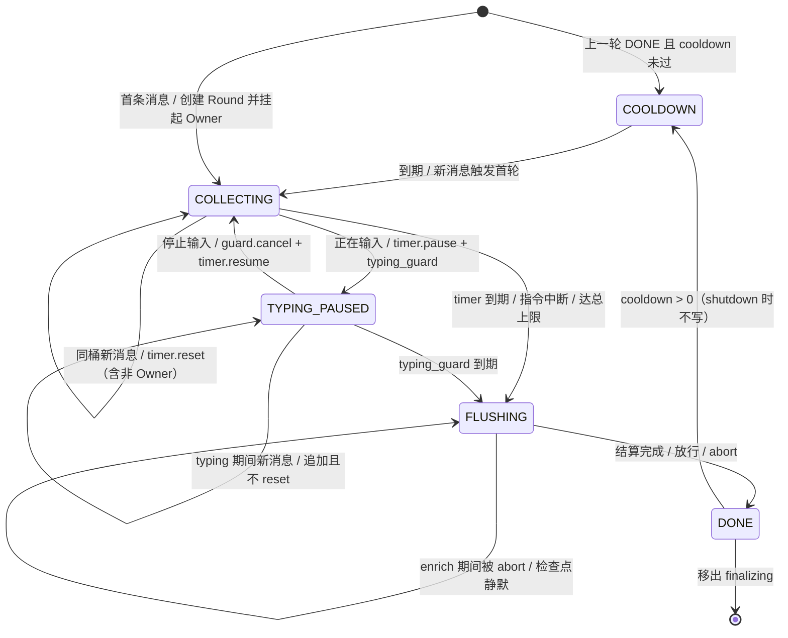

# 消息聚合插件 技术设计文档

| 项目 | 内容 |
| --- | --- |
| 文档编号 | TDD-MSG-AGG-001 |
| 版本 | **v0.9**（七轮评审：新增本地统计 + 插件可视化页面 + 优先级不足的根源修复） |
| 状态 | 待评审（M2.5 完成 + §20.1 的 **17 条**用例全绿后可进 M3；新增功能另需 §20.2 的 **7 条**全绿） |
| 最后更新 | 2026-10-24 |
| 目标平台 | AstrBot `>= 4.26` |
| 参考实现 | [astrbot_plugin_continuous_message v2.9.2](../repo/README.md) |
| 代码基线 | AstrBot `master`（本地 `astrbot-src/`，仅 core/api）；页面部分另核 `4.28.1` 完整检出 |

### 变更记录

| 版本 | 变更 |
| --- | --- |
| v0.1 | 首版：以"工程正确性"为目标，非目标含"不做群聊" |
| v0.2 | 目标改为**采用率优先** |
| v0.3 | 修正 5 个 P0：群聊可达性、附件保活时机、`untrack` 语义、typing 暂停、指令中断顺序 |
| v0.4 | 修正 10 处落地缺陷（F1–F10）；新增 `finalizing` 双表、I11/I12 |
| v0.5 | 修正 F13–F17：`finalizing` 按 `round_id`、`_on_fire` 绑实例、同步冻结、取消安全、`abort` 三态幂等 |
| v0.6 | 修正 P1-1/P1-2/P1-3：计时器按 Round 复用、中断全量 abort、shutdown 不写 cooldown |
| **v0.7** | 五轮评审。**P0-1** `_finalize` 只在入口检查 `shutting_down`，`enrich` 期间被 abort/shutdown 后仍会 `reconstruct` 放行半成品 → 新增 **I18：每个 `await` 之后必须重新检查**，并明确"为什么不做 `finalize_task` 取消"（11.2）。**P1-1** `DebounceTimer._cancel` 会自取消（timer/watchdog 自己触发 `_on_fire`）→ 跳过当前任务。**P1-2** `_on_typing` 硬编码中文文案 → 改为结构化优先 + 文案 fallback + 无法判定即 no-op。**P1-3** 门禁口径统一为 17 条、M2.5 上调至 1.0 人日。P2 七条并入（`dedupe` 移到 normalize 之后、`_on_recall` 实现、`typing` 复位、`end_finalize` 幂等短路等） |
| **v0.8** | 六轮评审：**补两处一直悬空的东西**。(1) **本地统计（§19.2）**：§2 把 A2/A3 的采集方式写成"本地计数"，却从未规格化，§23-Q3 又自认"遥测缺失导致 A1/A3 不可量化"——本版把计数口径、维度上限、落盘时机、隐私红线补齐，并把 `snapshot_state()` 从"瞬时快照"扩展为"快照 + 累计 + 环形历史"。(2) **插件可视化页面（§24）**：把 §5 里 P2 的"可视化面板"提到 P1 并定案（解决 §23-Q2），落成 `pages/status/` + `register_web_api` + bridge 的完整规格。两处都守住"核心零依赖 / 只用公开 API / 失败可见"。附带核实 4.28.1 与 master 的页面差异（目录名 `pages` vs `views`、i18n 键 `pages.*` vs `views.*`），两者**同时写**才能跨版本正确 |
| **v0.9** | 七轮评审：**从根源修复"优先级不足"（§25）**。原方案把 `priority=50` 当作"够高"，但派发循环是 `if event.is_stopped(): break`，且排序键没有上限——于是"够不够"随用户装了什么插件而变，是**无法证明已解决**的问题。本版三件事：① 优先级取插件层顶格 `1000`（说明为何不用 `sys.maxsize`：内置会话控制正是该值，并列胜负取决于注册顺序）；② 新增不在派发循环内的 `OnLLMRequestEvent` 抢占检测——**把"静默不工作"变成"可见降级"**（`aggregate.preempted` + `preempted_total`）；③ 明确被抢占不留半成品。核心判断：**从"赌自己先跑"改成"输了也一定知道"** |

> **v0.7 的核心判断**：前六版的所有不变式都建立在"Owner 只在两个离散点（`_after_flush`、`_finalize` 入口）检查放弃标志"这一假设上。**一旦 `_finalize` 内部有 `await`，这个假设就失效**——而 `enrich` 恰恰是一个最长 12s 的 `await`。这条缺口只在装了增强包时暴露，恰好是"默认配置下测不出来"的那类。本版把检查点下沉到每个 `await` 之后，并把"放弃"从"设标志"升级为"可达所有 await 的契约"。

> **v0.8 的核心判断**：前七版把"可观测性"当成了日志问题（§19 只有日志事件 + 一个内存快照），于是 §2 里 A2/A3 的采集方式是一句"本地计数"、§23-Q3 又承认"不可量化"——**这两个陈述同时存在，说明采集层从来没被设计过**。本版补的是这一层：统计必须是**同步累加、后台落盘、有界维度**，否则它就会变成事件路径上的 IO（破坏 §18 的 <1ms 预算）或无界内存（群聊下按 `umo`×`sender` 爆炸）。页面则是下游消费者，它的规格反过来约束了统计必须提供什么（累计、历史、变化通知）。
>
> 第二条判断关于页面本身：**页面能做的事情越少，它就越不可能成为新的故障源**。所以本版只给它两个写操作（切预设、清统计），其余全是只读；并且 SSE 采用**定时推送 + 变化才推**，而不是事件驱动——否则群聊高频会反过来压垮 WebUI，把"观测工具"变成"负载来源"。

---

## 1. 背景

AstrBot 的每条平台消息独立走完一整条处理管线（唤醒 → 白名单 → 限流 → 内容安全 → 插件 → LLM → 回复）。用户把一句话拆成多条发送时，会产生重复的 LLM 调用和割裂的上下文。

参考实现用"拦截—缓冲—重构事件"解决了这个问题，但它的定位是**私聊专用**，且把 1900 行站点爬虫写进了主包。这两点决定了它的用户上限。

## 2. 采用目标与技术目标

| 类型 | 编号 | 目标 | 度量 | 采集方式 |
| --- | --- | --- | --- | --- |
| 采用 | A1 | 装得上 | 安装成功率 ≥ 98% | 市场侧配对统计或抽样调研 |
| 采用 | A2 | 用得上：私聊 + 群聊 | 已唤醒群消息中的群聊占比 ≥ 40%（受 8.2 约束） | `stats.by_channel["group"].flush / stats.flush_total`（本地累计，口径见 §19.2） |
| 采用 | A3 | 配得对：默认即可用 | 默认配置留存率 ≥ 80% | 首次启动写生效配置哈希 + 时间戳，≥7 天后比对（§19.2.4；**本地近似**，见该节局限） |
| 采用 | A4 | 出问题能自查 | "无反应"类 issue 占比 < 10% | issue 模板分类统计 |
| 技术 | G1 | 连续消息合并为一次下游处理 | 3 条 → 1 次 LLM 调用 | 集成测试 |
| 技术 | G2 | 合并后事件对下游完全透明 | 三处字段一致 | 集成测试 |
| 技术 | G3 | 无乱序、无重复、无丢失 | 并发用例通过 | 竞态测试 |
| 技术 | G4 | 附件跨事件不丢失 | 第 2+ 条图片可识别 | 附件测试 |
| 技术 | G5 | 核心零第三方依赖 | 空环境可运行 | CI smoke |

## 3. 目标用户与场景

### 3.1 场景修正说明

未唤醒的群消息在 `WakingCheckStage` 被 `stop_event()`（`waking_check/stage.py:249-252`，已核对），插件看不到。因此群聊场景限定为"连续唤醒的补充消息"。

| 用户 | 场景 | 当前的痛 | 本方案的应答 |
| --- | --- | --- | --- |
| **慢速打字用户**（私聊） | "今天天气怎么样" / "我想去爬山" / "需要准备什么" | 三条消息三次调用，AI 逐条回半句 | 合并 + 自适应等待（P0） |
| **群聊提问者** | 在群里**连续 @bot** 补充说明 | 参考实现不处理群聊；每条 @ 都独立触发 | 按发送者分桶合并（P0）；**仅已唤醒消息** |
| **重图文用户** | 发链接、发图、发卡片 | 模型看不到链接内容，图片丢失 | 可选增强包（P1） |
| **自建/低成本用户** | 小主机、Docker、无外网 | 依赖 `curl_cffi` 编译失败 | 核心零依赖（P0） |

> **明确不承诺**："@bot 一次后，后续不 @ 的消息也合并"。受 core 唤醒阶段约束，插件层无法实现。

## 4. 竞品缺口

| 能力 | 参考实现 v2.9.2 | 本方案 v0.8 |
| --- | --- | --- |
| 私聊合并 | ✅ | ✅ |
| **群聊合并** | ❌ 明确放弃 | ✅ 按 `(会话, 发送者)` 分桶，仅已唤醒消息 |
| 输入状态感知 | ✅ 仅 NapCat | ✅ 能力探测 + 结构化优先判定 |
| 撤回过滤 | ✅ 仅 OneBot v11 | ✅ 能力探测 + `message_id` 索引 |
| 链接/卡片增强 | ✅ 内置 1900 行爬虫 | 🔶 可选增强包 |
| 额外依赖 | 3 个三方包 | 无 |
| 安装失败可诊断 | ❌ 静默 `enabled=False` | ✅ 启动日志明示 |
| 等待期用户反馈 | ❌ 最长静默 60s | ✅ typing 提示 |
| 调试可视化 | ❌ 只有日志 | ✅ 累计统计 + 运行历史 + **插件视图**（§19.2 / §24） |
| 配置预设 | ❌ 十几个数值项 | ✅ 三档预设 |

> 市场上另有同类防抖插件（如 `astrbot_plugin_message_merger`），其能力矩阵待补。

**结论：差异化不是"算法更好"，而是"群里也能用 + 装上就能用"。**

## 5. 功能优先级

| 级别 | 功能 | 理由 |
| --- | --- | --- |
| **P0** | 私聊 + 群聊分桶合并 | 覆盖面翻倍 |
| **P0** | 核心零三方依赖 | 安装成功率 |
| **P0** | 默认配置可用 + 三档预设 | 留存 |
| **P0** | 事件挂起 + 静默 + 重构 | 正确性地基 |
| **P0** | 附件 ingest 持久化 | 否则第 2 条起丢图 |
| **P0** | Round 生命周期（退役/取消/幂等） | 否则偶发卡死/丢消息 |
| **P0** | 计时器所有权（每 Round 单实例） | 否则延长等待失效 |
| **P0** | 放弃标志的 await 级可达性（v0.7） | 否则装增强包后中断超时=乱序 |
| P1 | typing 反馈、等待可感知 | 静默 12s 是最常见的"它卡住了"误解 |
| P1 | **本地统计与运行历史（§19.2）** | A2/A3 的采集方式至此才有实现；也是"合并率"的唯一证据 |
| P1 | **插件可视化页面（§24）** | 把"A4 出问题能自查"从"翻日志"降到"看一眼"；原为 P2，v0.8 上调 |
| P1 | 能力探测 + 多适配器兼容 | 不止 QQ 用户 |
| P1 | 失败可诊断 | 减少 issue |
| P1 | 配置迁移与热重载安全 | 升级体验 |
| P2 | 链接/卡片增强（独立包） | 有价值但非核心 |
| P2 | 打断正在生成的回复 | 需 core 协同，风险高 |
| P3 | 语义级"说完了没"判定 | 启发式已够 |

## 6. 设计原则

1. **默认可用**：默认配置就是"大多数用户想要的那个"。
2. **失败可见**：任何降级都说清"什么失败了、影响什么"。
3. **单事件真相**：一个桶在任一时刻最多一个事件挂起，其余立即静默退出。
4. **状态可派生**：缓冲文本与图片从 `items` 派生。
5. **只用公开 API**。
6. **快照结算**：结算在快照上进行，不阻塞入队。
7. **核心零依赖**。
8. **资源早持久化**。
9. **状态转移原子**：退役、冻结、放行在同一同步块完成，中间无 `await`。
10. **协程生命周期等价于状态生命周期**：任何挂起点都必须能响应取消并完成清理。
11. **身份优先于键**：Round 归属以 `round_id` 判定，不以 `BucketKey` 判定。
12. **单一所有者**：每个可变资源只有一个持有者，替换必先释放，销毁必被取消。
13. **放弃必须在每个 `await` 之后可达**（v0.7）：只检查入口等于没检查；`reconstruct` 之前是最后一道闸。
14. **观测不得改变被观测者**（v0.8）：统计累加同步无 IO、不 `await`；页面只读快照，不调用任何状态机转移函数（`get_or_create` / `begin_finalize` / `abort`）。**一个会拖慢或改变主流程的观测工具，比没有观测更糟。**

## 7. 术语

| 术语 | 含义 |
| --- | --- |
| UMO | `unified_msg_origin`，格式 `平台:消息类型:会话ID` |
| 桶（Bucket） | 聚合基本单位 `(umo, sender_id)`；私聊退化为按会话 |
| 轮次（Round） | 一次从"首条消息到达"到"结算完成"的聚合周期 |
| `round_id` | Round 的唯一身份；`finalizing` / `done` / `abort` 均按它索引 |
| Owner 事件 | 轮次中被挂起等待、承载合并结果的事件 |
| 静默（Silence） | 让事件停止传播且不产生输出 |
| 冻结（Freeze） | 在 `begin_finalize` 内同步生成不可变快照 |
| 退役（Retire） | `active → finalizing` 的同步动作，含冻结、取消看门狗、清索引 |
| 检查点（Checkpoint） | `_finalize` 内每个 `await` 之后对 `shutting_down` 的复查 |
| Cooldown | 同桶上一轮 DONE 后的间隔，作为 `debounce < min_interval` 时的保护网 |
| 合并率（Merge ratio） | `items_total / flush_total`，即"每条下游调用承载了几条用户消息"；G1 的量化口径 |
| `FlushRecord` | 一轮结算的**元数据**记录（计数、耗时、原因），**不含消息正文**；页面历史表的数据源 |
| 变化通知（Revision） | 统计快照的单调递增版本号；页面 SSE 只在它变化时推送（§24.4） |

## 8. 总体架构

### 8.1 在 AstrBot 管线中的位置

```
WakingCheckStage → WhitelistCheckStage → SessionStatusCheckStage → RateLimitStage
    → ContentSafetyCheckStage → PreProcessStage
    → 【ProcessStage: StarRequestSubStage（插件 handler）→ AgentRequest】
    → ResultDecorateStage → RespondStage
```

handler 注册在 `ProcessStage / StarRequestSubStage`，`priority = 1000`（v0.9 起；原为 50）。

> `core/star/star_handler.py` 按 `-priority` 排序，**数值越大越先执行**。参考实现把 `priority=50` 称为"低优先级"是错的；50 表示早于默认 0 的插件执行，这正是拦截型插件需要的。

但 50 只是"略高于默认 0"，**挡不住任何刻意设置更高优先级的插件**。v0.9 把优先级取到**插件层顶格**（1000，远高于 1~100 的常见约定），并且——更重要的是——**不再依赖自己一定先跑**：另有一个不在派发循环里的 LLM 请求钩子做抢占检测。详见 **§25**。

### 8.2 群聊的可达性约束

`WakingCheckStage` 在未唤醒时 `stop_event()`（`stage.py:249-252`），插件不可见。有效范围：

> 用户在群里**已唤醒（@机器人 / 唤醒前缀）**的连续消息，按发送者分桶合并。

必须写进 README，且**不承诺"@一次后不 @ 的后续消息"被合并**。

### 8.3 模块划分

```
astrbot_plugin_msg_aggregator/
├── main.py                 # handler 注册、事件分流、结算编排、web api 注册
├── session.py              # SessionStore：active / finalizing / index / cooldown
├── timer.py                # DebounceTimer：每 Round 单实例，_cancel 跳过当前任务
├── strategy.py             # 等待策略（纯函数，注入 Clock）
├── event_io.py             # 入参解析 / 出参重构 / 静默
├── attachments.py          # ingest 持久化 + 引用归一化 + TTL
├── config.py               # typed 配置 + 别名映射 + 预设 + 校验
├── capabilities.py         # 平台能力探测 + typing 判定映射
├── observability.py        # 结构化日志 + 状态快照
├── stats.py                # 本地统计 + 环形历史 + 原子落盘（§19.2）
├── web_api.py              # 页面后端：register_web_api 的 handler（§24.3）
├── pages/status/           # 插件可视化页面（4.28.1 兼容目录名，见 §24.1）
│   ├── index.html
│   ├── app.js
│   └── style.css
├── .astrbot-plugin/i18n/   # 页面标题/文案（zh-CN、en-US）
├── extensions/             # P2：可选增强包
└── tests/
```

依赖单向：`main → (session, event_io, strategy, capabilities, extensions, stats, web_api)`，`session → timer`，`web_api → (stats, session, config)`。`strategy` / `config` / `event_io` / `stats` 只依赖标准库。

> `web_api` 只**读取** `session` 与 `stats`，**写**只经由 `config`（预设）与 `stats.reset`；它绝不触碰 `Round` 的内部字段（§24.3 只读契约）。

### 8.4 `strategy.compute` 规格

```python
def compute(self, rnd: Round, now: float, cooldown_remaining: float) -> float:
    """计算本轮下一次等待秒数。

    调用约束：typing 期间调用方不得调用本函数（10.1）。

    计算顺序（后者覆盖前者）：
      1. 非自适应 → w = cfg.debounce_time；
         自适应 → 按长度分档 + 结尾标点 + 连续短句加成，clamp 到
         [adaptive_min_wait, adaptive_max_wait]；
      2. 总上限：w = min(w, started_at + adaptive_max_total_wait - now)；
      3. cooldown：w = max(w, cooldown_remaining)（仅当 debounce < min_interval 时生效，10.2）。

    Returns:
        等待秒数；<= 0 表示应立即结算（调用方直接 `_on_fire(rnd)`）。
    """
```

## 9. 数据模型

```python
BucketKey = tuple[str, str]        # (umo, sender_id)

@dataclass(frozen=True, slots=True)
class Part:
    """保留图文交错顺序的最小单元。"""
    kind: Literal["text", "image"]
    value: str

@dataclass(frozen=True, slots=True)
class Item:
    """不可变；撤回通过 dataclasses.replace 生成新实例（11.7）。"""
    message_id: str | None
    parts: tuple[Part, ...]
    arrived_at: float
    recalled: bool = False
    image_bytes: int = 0           # 缓存后实际落盘字节数（13.4）

    def text(self) -> str:
        return "".join(p.value for p in self.parts if p.kind == "text")

    def images(self) -> tuple[str, ...]:
        return tuple(p.value for p in self.parts if p.kind == "image")

@dataclass(slots=True)
class Round:
    round_id: int                          # 唯一身份（F15/F16）
    key: BucketKey
    owner_event: AstrMessageEvent          # I1
    items: list[Item] = field(default_factory=list)
    frozen: Snapshot | None = None         # begin_finalize 同步冻结
    flush: asyncio.Event = field(default_factory=asyncio.Event)
    done: asyncio.Event = field(default_factory=asyncio.Event)
    timer: DebounceTimer | None = None     # 每 Round 单实例，复用（P1-1 v0.6）
    typing_guard: asyncio.Task | None = None
    started_at: float = 0.0
    typing: bool = False
    short_streak: int = 0
    committed_bytes: int = 0
    shutting_down: bool = False            # abort 置位；每个检查点复查（I18）
    channel: str = "private"               # "private"|"group"，创建时定；统计按渠道分（§19.2.1）
    stats_recorded: bool = False           # 统计一次性归类标记（§19.2.1）：保证每轮只记一次
    state: RoundState = RoundState.COLLECTING

@dataclass(frozen=True, slots=True)
class Snapshot:
    items: tuple[Item, ...]
    def text(self, sep: str) -> str: ...
    def images(self) -> list[str]: ...

# ---- 统计（v0.8）：累加必须同步、无 IO、无界增长必须被截断 ----

@dataclass(slots=True)
class ChannelStats:
    """按渠道（private / group）的累计计数。"""
    flush: int = 0
    abort: int = 0
    items: int = 0
    images: int = 0
    elapsed_ms_sum: float = 0.0

@dataclass(frozen=True, slots=True)
class FlushRecord:
    """一轮结算的元数据。**不含任何消息正文**（隐私红线，§19.2.3）。"""
    ts: float
    round_id: int
    umo: str                      # 已按 UMO_MAX_LEN 截断
    sender: str                   # 已按 SENDER_MAX_LEN 截断
    channel: Literal["private", "group"]
    items: int
    images: int
    elapsed_ms: int
    outcome: Literal["done", "abort", "drop"]

@dataclass(slots=True)
class Stats:
    """进程内累计；所有 `add_*` 都是同步 O(1)，绝不 await、绝不碰磁盘。"""
    flush_total: int = 0
    abort_total: int = 0
    drop_total: int = 0
    items_total: int = 0
    images_total: int = 0
    bytes_cached_total: int = 0
    interrupt_total: int = 0
    interrupt_timeout_total: int = 0
    typing_unknown_total: int = 0
    dim_overflow_total: int = 0            # 维度表满后拒绝新增的次数（§19.2.2）
    by_channel: dict[str, ChannelStats] = field(default_factory=dict)
    by_umo: dict[str, int] = field(default_factory=dict)      # 有上限
    by_sender: dict[str, int] = field(default_factory=dict)   # 有上限，仅群聊
    drop_by_cause: dict[str, int] = field(default_factory=dict)
    elapsed_hist: Histogram = field(default_factory=Histogram)  # 固定桶，非精确分位
    history: deque[FlushRecord] = field(default_factory=deque)  # 构造时按 stats_history_size 定 maxlen
    revision: int = 0                      # 每次变更 +1，供页面判定"要不要推"（§24.4）
    first_seen_at: float = 0.0             # A3 口径（§19.2.4）
    first_config_hash: str = ""
    default_kept: int = 0                  # A3：首次配置沿用 ≥7 天的次数（本地近似）

# ---- 内部常量（不做成配置：没有需要用户调的理由，见 §15.2 的取舍）----
UMO_MAX_LEN = 64          # 落盘/展示前截断
SENDER_MAX_LEN = 32

@dataclass(frozen=True, slots=True)
class StatsSnapshot:
    """对外只读投影：页面/日志都只能拿到它，拿不到可变引用。"""
    counters: Mapping[str, int]
    merge_ratio: float                     # items_total / max(1, flush_total)
    by_channel: Mapping[str, ChannelStats]
    by_umo_top: tuple[tuple[str, int], ...]     # 已按 count 降序截断
    by_sender_top: tuple[tuple[str, int], ...]
    drop_by_cause: Mapping[str, int]
    latency: LatencySummary                # p50_ms / p95_ms / buckets
    history: tuple[FlushRecord, ...]
    revision: int
    saved_at: float
```

**为什么是桶而不是会话**：私聊 `sender_id` 恒定 → 退化为按会话；群聊自动"每人独立聚合"，从数据结构上消除越权。

**为什么引入 `Part`**：保留图文交错顺序；`text()` / `images()` 仍可派生。默认不保序（`preserve_part_order: false`），见 11.3。

### 9.1 `SessionStore`

四张表：`active`、`finalizing`（按 `round_id`）、`index`、`cooldown`。

`finalizing` 以 **`round_id`** 为键而不是 `BucketKey`：`finalize_lock` 只保证**串行**，不保证**唯一**——同一桶可同时有"Round 1 结算中 + Round 2 收集中"。

```python
class SessionStore:
    active: dict[BucketKey, Round]
    finalizing: dict[int, Round]                # round_id -> Round
    index: dict[Any, BucketKey]                 # message_id -> key（I9）
    cooldown: dict[BucketKey, float]

    def get_or_create(self, key, owner_event, make_id) -> Round:
        """取现有 Round 或创建；round_id 只在创建分支消耗（P2-4 v0.6）。"""
        rnd = self.active.get(key)
        if rnd is not None:
            return rnd
        rnd = Round(round_id=make_id(), key=key, owner_event=owner_event,
                    started_at=self.clock.now())
        self.active[key] = rnd
        return rnd

    def begin_finalize(self, rnd: Round) -> bool:
        """同步退役：身份校验 → 冻结 → 移出 active → 登记 finalizing → 清索引。

        Args:
            rnd: 待退役的轮次。

        Returns:
            True 表示真正完成了退役；False 表示该轮已被 abort 或已被其他路径
            退役（陈旧计时器、指令中断抢先），调用方各自处理。
        """
        if self.active.get(rnd.key) is not rnd:      # F15：身份校验
            return False
        del self.active[rnd.key]
        rnd.frozen = rnd.snapshot()                  # 同步冻结，无 await
        rnd.state = RoundState.FLUSHING
        rnd.typing = False                           # P2-3：与快照输出一致
        if rnd.timer:
            rnd.timer.cancel()                       # 不取消"当前任务"（9.2）
        if rnd.typing_guard and not rnd.typing_guard.done():
            rnd.typing_guard.cancel()                # P2-2 v0.6：退役即取消看门狗
            rnd.typing_guard = None
        self.finalizing[rnd.round_id] = rnd
        for item in rnd.frozen.items:
            if item.message_id is not None:          # F6：缺失不建索引
                self.index.pop(item.message_id, None)
        return True

    def end_finalize(self, rnd: Round, cooldown: float) -> None:
        """幂等收尾；已完成则短路（P2-5）。"""
        if rnd.state is RoundState.DONE and rnd.round_id not in self.finalizing:
            return
        self.finalizing.pop(rnd.round_id, None)
        rnd.state = RoundState.DONE
        if cooldown > 0:
            self.cooldown[rnd.key] = self.clock.now() + cooldown
        rnd.done.set()

    def abort(self, rnd: Round, cause: str) -> None:
        """幂等放弃：active / finalizing / 已 DONE 三种情形均安全（F17 / P2-8）。

        本方法**不静默 Owner**，也不取消正在 `_finalize` 的协程：
          - Owner 必须在 `_after_flush`（11.1）或 `_finalize` 的检查点（11.2 / I18）
            看到 `shutting_down` 后自己静默；
          - 正在 `_finalize` 的轮次由检查点中断，不必强杀任务（见 11.2 说明）。
        """
        if rnd.state is RoundState.DONE:
            return
        rnd.shutting_down = True
        if rnd.timer:
            rnd.timer.cancel()
        if rnd.typing_guard and not rnd.typing_guard.done():
            rnd.typing_guard.cancel()
        rnd.typing_guard = None
        if self.active.get(rnd.key) is rnd:
            del self.active[rnd.key]
            for item in rnd.items:
                if item.message_id is not None:
                    self.index.pop(item.message_id, None)
        # finalizing 中：持锁者会在 finally 里 end_finalize；此处只摘表并放行，
        # 避免 wait_idle 挂死。end_finalize 幂等，重复调用无副作用。
        self.finalizing.pop(rnd.round_id, None)
        rnd.state = RoundState.DONE
        rnd.flush.set()
        rnd.done.set()
        log.warning("aggregate.abort", extra={"key": rnd.key, "round_id": rnd.round_id,
                                              "cause": cause, "items": len(rnd.items)})

    def finalizing_rounds(self, key: BucketKey) -> list[Round]:
        """同键所有在结算中的轮次（0~2 个，见 18 章）。"""
        return [r for r in self.finalizing.values() if r.key == key]

    async def wait_idle(self, key: BucketKey) -> None:
        while True:
            pending = self.finalizing_rounds(key)
            if not pending:
                return
            await asyncio.gather(*(r.done.wait() for r in pending))
```

### 9.2 计时器所有权与自取消（P1-1 修法）

```python
def _arm_timer(self, rnd: Round, seconds: float) -> None:
    """复用 Round 自带的计时器对象，reset 内部 cancel-before-create（I2）。"""
    if rnd.timer is None:
        rnd.timer = DebounceTimer(self._clock, on_fire=lambda: self._on_fire(rnd))
    rnd.timer.reset(seconds)

def _on_fire(self, rnd: Round) -> None:
    if not self.store.begin_finalize(rnd):     # 身份不符 = 陈旧回调
        log.debug("aggregate.stale_timer", extra={"key": rnd.key, "round_id": rnd.round_id})
        return
    rnd.flush.set()                            # 同一同步块，中间无 await
```

**为什么必须复用对象**（v0.6 已定）：每次新建会让旧 `_task` 存活到首条到期时刻，`begin_finalize` 的身份校验**拦不住**（rnd 身份是对的、时间错了），从而在 t=2 提前结算、吞掉后续延长——即 F13 的修复被抵消。

**自取消**（v0.7 / P1-1）：`_on_fire` 正是由 `DebounceTimer._run` 或 `_typing_watchdog` 调用的，`begin_finalize` 里的 `rnd.timer.cancel()` 会 `cancel()` **当前正在执行的任务**。因此 `_cancel` 必须跳过当前任务：

```python
def _cancel(self) -> None:
    cur = asyncio.current_task()
    if self._task and self._task is not cur and not self._task.done():
        self._task.cancel()
    self._task = None
```

同理，`begin_finalize` / `abort` 取消 `typing_guard` 时也跳过 `asyncio.current_task()`。否则"用例 2 断言旧 task 全部 cancelled"的口径会随实现细节漂移（最后一个 task 可能是 finished 也可能被标记为 cancelled）。

## 10. 状态机



不变式：

| ID | 不变式 | 保障 |
| --- | --- | --- |
| I1 | 同一桶至多一个 Round、一个挂起 Owner | `active` 单键单值 |
| I2 | 同一 Round 至多一个活跃 debounce 计时器 + 一个 typing 看门狗 | 计时器对象按 Round 复用 + 看门狗 create-before-cancel |
| I3 | `text`/`images` 只从 `items` 派生 | 不提供 setter |
| I4 | 结算期间新消息不复用已退役 Round | `begin_finalize` 同步移出 `active` |
| I5 | Owner 必被放行或静默 | `try/finally` + `done.set()` |
| I6 | 增强 IO 不阻塞入队 | 结算在 `frozen` 上 |
| I7 | 同一桶的结算串行 | `finalize_lock(key)` |
| I8 | 群聊桶键必须含 `sender_id` | 类型层面强制 |
| I9 | `message_id -> key` 索引与 Round 生命周期同步 | `append` 建、`begin_finalize`/`abort` 清 |
| I10 | shutdown 时进行中的轮次必须静默，且不写 cooldown | `shutting_down` + **I18 检查点** + `finally` 判定 |
| I11 | 退役（含冻结、取消看门狗）与放行同步完成，中间无 `await` | `_on_fire` |
| I12 | `append` 只接受 `COLLECTING`/`TYPING_PAUSED` 状态的 Round | 入口断言 |
| I13 | `finalizing` 按 `round_id` 索引，`end_finalize`/`abort` 按身份幂等 | 身份比较 |
| I14 | `_finalize` 的任意取消点都必须保证 `end_finalize` 或 `abort` 至少执行一次 | `acquired` + 最外层 `finally` |
| I15 | 计时器回调绑定 Round 实例，陈旧回调被身份校验拦下 | `_on_fire(rnd)` |
| I16 | Owner 从 `flush.wait()` 返回后先检查 `shutting_down`，由 Owner 自己静默 | `_after_flush` |
| I17 | 中断超时必须覆盖该桶全部在结算轮次 | `finalizing_rounds(key)` 全量 abort |
| **I18** | **`_finalize` 内每个 `await` 之后都必须复查 `shutting_down`；`reconstruct` 之前是最后一道闸** | `_checkpoint(rnd)` |
| **I19** | **任何 `cancel()` 都不作用于当前正在执行的任务** | `_cancel` 跳过 `asyncio.current_task()` |

### 10.1 typing 语义与判定（P1-2 修法）

- 进入 `TYPING_PAUSED`：`timer.pause()` 记录剩余；创建 `typing_guard`，到期调 `_on_fire(rnd)`。
- 停止输入：取消 guard 并置 `None`；`timer.resume()` 按剩余恢复；剩余为 0 时立即结算。
- typing 期间新消息：追加到 `items`，**不得 `timer.reset`**（`reset()` 会清 `_paused_remaining`，等价解除暂停）。
- 重复"停止输入"：`typing == False` 时忽略。
- 进入 `FLUSHING`（`begin_finalize`）或 `abort` 时取消看门狗。

**判定方式**（P1-2）：不硬编码中文文案。优先级为 **结构化字段 → 文案 fallback → no-op**，映射常量集中在 `capabilities.py`（`TYPING_EVENT_TYPES`），便于按适配器覆盖而不改核心路径。

```python
# capabilities.py
TYPING_EVENT_TYPES: dict[Any, bool] = {1: True, 2: False}   # OneBot/NapCat input_status 扩展
TYPING_TEXT_MARKERS = ("正在输入", "typing")

def probe_typing(raw) -> bool | None:
    """返回 True=正在输入 / False=停止输入 / None=无法判定。

    依据：NapCat 的 input_status 扩展事件带 event_type 与 status_text，
    其中 event_type 非 OneBot v11 标准字段，缺失时只能回退到文案匹配。
    """
    et = raw.get("event_type")
    if et is not None:
        try:
            if int(et) in TYPING_EVENT_TYPES:
                return TYPING_EVENT_TYPES[int(et)]
        except (TypeError, ValueError):
            pass
    text = raw.get("status_text")
    if isinstance(text, str) and text:
        lowered = text.lower()
        if any(m in lowered or m in text for m in TYPING_TEXT_MARKERS):
            return True
        return False
    return None
```

```python
def _on_typing(self, event: AstrMessageEvent) -> None:
    """input_status 通知：只作用于已存在的桶，无副作用（11.5）。"""
    raw = event.message_obj.raw_message
    key = (event.unified_msg_origin, str(raw.get("user_id", "")))
    rnd = self.store.active.get(key)              # 只查 active；finalizing 不再收消息
    if rnd is None or rnd.timer is None:          # P2-6：防御未武装
        return
    state = probe_typing(raw)                     # None = 无法判定
    if state is None:
        log.debug("aggregate.typing_unknown", extra={"umo": key[0]})
        return
    if state:
        if rnd.typing:
            return
        rnd.typing = True
        rnd.timer.pause()
        rnd.typing_guard = asyncio.create_task(self._typing_watchdog(rnd))
    elif rnd.typing:
        rnd.typing = False
        if rnd.typing_guard and not rnd.typing_guard.done():
            rnd.typing_guard.cancel()
        rnd.typing_guard = None
        rnd.timer.resume()                        # 剩余为 0 时内部立即 on_fire

async def _typing_watchdog(self, rnd: Round) -> None:
    await asyncio.sleep(self.cfg.max_typing_wait)
    self._on_fire(rnd)                            # 内部做身份校验
```

> 判定失败只打 **debug**，不打 warning：部分适配器每次输入都发 notice，warning 会刷屏（对应 P2-4 的用例要求）。

### 10.2 cooldown 语义

- `DONE` 后写 `cooldown[key] = now + min_interval`；`active` 不留 Round。
- cooldown 内新消息：创建新 Round，首次 wait 取 `max(debounce, cooldown_remaining)`，**不丢弃**。
- `min_interval` 拆为 `min_interval_group`（0.5s）/ `min_interval_private`（0）。
- cooldown 是 `debounce < min_interval` 时**才生效的保护网**；默认 `debounce=2.0 > 0.5`，不产生额外延迟。
- **shutdown 期间不得写 cooldown**（P1-3 v0.6）。

### 10.3 指令中断口径

- `_interrupt(key)`：若 `active` 有同键桶则 `begin_finalize`；`flush.set()`；`await wait_idle(key)`，超时 `cfg.interrupt_wait`。
- **超时后 abort 该桶全部在结算轮次**（I17）。被 abort 的轮次由各自检查点静默（I18），不强杀协程（11.2 说明）。
- `interrupt_wait` 默认 `2.0`，加载时 `min(interrupt_wait, enrich_deadline)` 回填并记 debug 实际值。
- 超时记 `aggregate.interrupt_timeout`（含被 abort 的轮次数），指令照常下行。

## 11. 核心流程

```python
@filter.event_message_type(EventMessageType.ALL, priority=MESSAGE_PRIORITY)  # 1000，见 §25
async def on_event(self, event):
    if not self.cfg.enabled:
        return
    if is_input_status(event):
        self._on_typing(event); return           # 同步、只查表
    if is_recall(event):
        self._on_recall(event); return
    if not self._accepts(event):
        return
    if self.access.event_mode(event) is DENY:
        return

    parsed = parse_incoming(event, self.cfg)     # 纯函数

    # F4：先判指令，再持久化附件，避免命令消息产生孤儿缓存
    if is_command(parsed.text, self.cfg.prefixes):
        await self._interrupt(self._key(event))
        return
    if not parsed.has_content:
        return

    parsed = await self.attachments.persist(parsed)
    if self.access.event_mode(event) is IMMEDIATE:
        await self._finalize_immediate(event, parsed); return

    key = self._key(event)
    rnd = self.store.get_or_create(key, event, make_id=self._next_round_id)
    self.store.append(rnd, parsed)               # I12 + I9 + 13.4 配额

    # F13：Owner 与非 Owner 都要延长等待（从最后一条起算）；
    #       例外是 TYPING_PAUSED（此时不得 reset，见 10.1）。
    if rnd.state is not RoundState.TYPING_PAUSED:
        wait = self.strategy.compute(rnd, self._clock.now(),
                                     self.store.cooldown_remaining(key))
        self._arm_timer(rnd, wait)               # P1-1 v0.6：复用同一计时器对象

    if rnd.owner_event is not event:
        self._silence(event)                      # 非 Owner：常规静默，不计数（§19.2.1）
        return

    try:
        await rnd.flush.wait()
        await self._after_flush(rnd)              # I16
    except asyncio.CancelledError:
        self.store.abort(rnd, cause="cancelled")  # 幂等
        raise
```

### 11.1 `_after_flush`：Owner 的第一出口

```python
async def _after_flush(self, rnd: Round) -> None:
    """Owner 从挂起返回后的唯一分支点。

    注意：abort 之后必须由 Owner **自己**静默，不能裸 return，否则该事件会带着
    首条消息继续流向下游，产生一条多余的回复。
    """
    if rnd.shutting_down:
        self._silence(rnd.owner_event, cause="abandoned")
        self.store.end_finalize(rnd, cooldown=0.0)   # 幂等
        return
    await self._finalize(rnd)
```

### 11.2 结算（检查点化，P0-1 修法）

```python
async def _finalize(self, rnd: Round) -> None:
    acquired = False
    try:
        async with self.store.finalize_lock(rnd.key):   # 取消可能发生在这里
            acquired = True
            snap = rnd.frozen or rnd.snapshot()
            # 检查点 ①：入口
            if self._abandoned(rnd):
                self._silence(rnd.owner_event, cause="abandoned"); return
            try:
                text = snap.text(self.cfg.separator)
                images = list(snap.images())
                text, images = await self.ext.enrich(text, images,
                                                     deadline=self.cfg.enrich_deadline)
                # 检查点 ②：enrich 之后（最长 12s 的 await，I18 的关键位置）
                if self._abandoned(rnd):
                    self._silence(rnd.owner_event, cause="abandoned"); return
                text, images = self.attachments.normalize(text, images)
                images = dedupe(images)                  # P2-1：normalize 之后去重
                # 检查点 ③：reconstruct 之前（最后一道闸）
                if self._abandoned(rnd):
                    self._silence(rnd.owner_event, cause="abandoned"); return
                if not text and not images:
                    self._silence(rnd.owner_event, cause="empty"); return
                if self.cfg.preserve_part_order:
                    reconstruct_ordered(rnd.owner_event, snap, images, self.cfg)
                else:
                    reconstruct(rnd.owner_event, text, images, self.cfg)
            except Exception:
                log.exception("aggregate.finalize_failed")
                self.store.abort(rnd, cause="finalize_failed")
                self._silence(rnd.owner_event, cause="failed")
    finally:
        # F14：无论是否拿到锁、是否被取消，都必须退场一次（幂等）。
        # P1-3：shutdown 期间不写 cooldown。
        cooldown = (self._cooldown_for(rnd.key)
                    if acquired and not rnd.shutting_down and not self._shutting_down
                    else 0.0)
        self.store.end_finalize(rnd, cooldown)

def _abandoned(self, rnd: Round) -> bool:
    """放弃判定：单轮 abort 或整插件 shutdown（I18）。"""
    return rnd.shutting_down or self._shutting_down
```

**为什么只做检查点、不做 `finalize_task` 取消**（对评审建议 #1 的取舍）：

- 取消正在 `_finalize` 的任务，`CancelledError` 会在 `await enrich` 处抛出，最终传播到 `on_event`。要么在 `_finalize` 里**吞掉**这个取消（仅在"是我们自己 abort 的"时），要么让 Owner 的管线任务被取消。前者的风险是**连带吞掉框架的 shutdown 取消**，后者让"静默"依赖任务死亡这种隐式行为。
- 检查点方案下，`_finalize` 走完 `enrich` 后必然在检查点返回，**不可能 `reconstruct`**；代价是它继续持锁到 `enrich` 结束（≤ `enrich_deadline`）。这段时间 Round 2 排队等锁，与 R9 已有的预算同阶，不引入新的量级。
- 结论：**正确性由检查点保证，延迟由既有预算吸收**；取消方案带来的是延迟优化，但引入两个新的语义分支，不符合"失败可见、状态可证"的取向。

> 若 M6 后实测"中断超时后 Round 2 等待过久"，再单独评审"检查点 + 取消"的混合方案，并同步为 `CancelledError` 定义"自取消 vs 外部取消"的判别规则。

### 11.3 事件重构

```python
def reconstruct(event, text, images, cfg) -> None:
    event.message_str = text                    # ① LLM 与多数插件
    event.message_obj.message_str = text        # ② 部分插件
    sync_raw_message(event, text, images)       # ③ aiocqhttp 系插件
    event.message_obj.message = build_chain(text, images, cfg)
```

图片构件顺序：缓存绝对路径走 `Image.fromFileSystem`，`scheme://`（含 `base64://`）走 `Image.fromURL`，否则 `Image(file=...)`。单图失败只丢该图 + warning。

**`reconstruct_ordered`（消费规则）**：

1. 以 `snap.items` 的 `Part` 顺序为骨架；
2. 遇图片 Part → 取归一化引用，在 `images` 中查**尚未消费**的同引用项，找到则消费并生成组件，找不到则跳过；
3. 同一 URL 在 `snap` 出现两次而 `images` 只有一次 → **首次保留，后续视为丢弃**；
4. `images` 中剩余未消费项（增强包新增）**按原顺序追加链尾**；
5. 追加图片不带文本占位符；`message_str` 仍为纯文本拼接——**下游不能假设二者一一对应**。

**`dedupe` 口径（P2-1）**：在 `normalize` **之后**执行，覆盖"快照原有 + 增强新增"的合并结果——否则增强包返回的 URL 可能与已有图重复，导致同一张图传两次。去重键为归一化后的引用字符串，保持首次出现顺序；**不用内容哈希**（避免为去重多读一次文件；新增图可能是远程 URL）。

### 11.4 指令中断

```python
async def _interrupt(self, key: BucketKey) -> None:
    rnd = self.store.active.get(key)
    if rnd is not None:
        # 失败有两种原因，均无需在此处理：
        #   a) 计时器先到，已由 _on_fire 退役 → 状态已是 FLUSHING；
        #   b) 已被 abort → 状态已是 DONE。
        # 两种情况都已在 finalizing 或已收尾，继续走下面的等待即可。
        self.store.begin_finalize(rnd)
        rnd.flush.set()
    if not self.store.finalizing_rounds(key):
        return
    try:
        await asyncio.wait_for(self.store.wait_idle(key), timeout=self.cfg.interrupt_wait)
    except asyncio.TimeoutError:
        pending = self.store.finalizing_rounds(key)
        log.warning("aggregate.interrupt_timeout",
                    extra={"key": key, "pending": len(pending)})
        for r in pending:                                # I17：全量覆盖
            self.store.abort(r, cause="interrupt_timeout")
```

指令本身不进入聚合，只用于打断当前轮。

### 11.5 通知事件的处理边界

`_on_typing` / `_on_recall` 在 `_accepts` **之前**执行，且**不额外做 `_accepts` 判定**：

- 群聊的 `input_status` 是 notice，`is_wake` 未必为真；在此补 `_accepts` 会把群聊输入感知整体误杀。
- 安全性由"**只查表、不建表**"保证：`_on_typing` 查 `active`（10.1 有实现），`_on_recall` 查索引（11.7），查不到即 no-op。两者无副作用。

### 11.6 结算开始后的撤回

`begin_finalize` 内**同步冻结快照**后，索引在同一同步块内清除。因此：

> **结算开始之后到达的撤回事件一律不生效**，属于已冻结快照的一部分。

有意的取舍：冻结与清索引必须原子，否则会出现"索引已清但快照未取"的中间态。写入 13.6 已知限制并由用例锁定。

### 11.7 `_on_recall` 实现（P2-2）

```python
def _on_recall(self, event: AstrMessageEvent) -> None:
    """撤回通知：按索引定位桶，置 recalled 标记。只查表，无副作用。"""
    mid = get_recalled_message_id(event)
    if mid is None:
        return
    key = self.store.index.get(mid)
    if key is None:
        return                                    # 未命中：已结算/非本插件
    rnd = self.store.active.get(key)
    if rnd is None:
        return                                    # 已退役：冻结快照不再接受撤回
    for i, item in enumerate(rnd.items):
        if item.message_id == mid:
            rnd.items[i] = dataclasses.replace(item, recalled=True)   # Item 为 frozen
            log.info("aggregate.recall", extra={"umo": key[0], "message_id": mid,
                                                "remaining": len(rnd.items) - 1})
            return
```

已结算轮次不再接受撤回（11.6），`recalled` 只影响 `snapshot()` 的过滤结果。

## 12. 群聊设计

### 12.1 可达性

未唤醒的群消息在 `WakingCheckStage` 被停止（`stage.py:249-252`），插件不可见。群聊只处理**已唤醒**消息。

README 必须写：

> 群聊合并仅在每条消息都唤醒机器人时生效（@bot 或唤醒前缀）。若你希望"@一次后连续补充"，请给 core 提需求，插件层无法绕过唤醒阶段。

### 12.2 分桶与越权

```python
def _key(event) -> BucketKey:
    return (event.unified_msg_origin, str(event.get_sender_id()))
```

- 群 A 张三 vs 群 A 李四 → 两桶；
- 群 A 张三 vs 群 B 张三 → 两桶（`umo` 不同）；
- 私聊退化：`sender_id` 恒定 → 等价按会话。

**越权红线**：合并结果的 `sender_id` / `sender_name` 取自 Owner 事件，绝不修改；`reconstruct` 只改 `message_str`、组件链、`raw_message`。测试必须断言。

### 12.3 @ 提及的处理

剥除**指向机器人自己**的 `At`（比对 `event.get_self_id()`），保留 `AtAll` 与其他成员的 `At`（后者有语义）。剥除数记 debug。比对失败（多账号/改名）时保留原文 + warning。

### 12.4 白名单/黑名单语义

`get_sender_id()` 与 `umo` 双匹配；**群聊默认不做白名单过滤**（名单为空即不过滤），避免"装完没反应"。若显式启用，日志打印命中的匹配字段。

### 12.5 频控与 cooldown

`min_interval_group`（0.5s）约束同桶轮次间隔；语义见 10.2。私聊默认 0。

### 12.6 撤回索引

`SessionStore.index: message_id -> BucketKey`。`append` 建，`begin_finalize` / `abort` 清。撤回 O(1) 定位，未命中忽略。**`message_id` 为 `None` 时不建索引**，否则所有缺失 ID 的消息共享 `None` 键并跨桶覆盖。

## 13. 附件生命周期

### 13.1 问题

`event_context` 退出时调用 `cleanup_temporary_local_files()`。第 2+ 条消息的事件在防抖窗口内就结束，其临时图片在结算时已被删除。**v0.2 把 `materialize` 放在 finalize 是错的**：那时原文件已不存在。

### 13.2 方案对比

| 方案 | 内存 | 磁盘 | 跨事件安全 | 成本 | 结论 |
| --- | --- | --- | --- | --- | --- |
| A. 转 `base64://` | ×1.33 | 无 | 是 | 低 | 参考实现；大图内存不可控 |
| B. `untrack_temporary_local_file()` | 0 | 依赖原文件 | 是（不删） | 最低 | 简单但永不回收 |
| C. ingest 时复制到缓存目录 + TTL | 0 | +1 份 | 是 | 中 | **采用** |

### 13.3 流程

```python
async def persist(self, parsed: Parsed) -> Parsed:
    for ref in parsed.local_temp_refs:
        try:
            cached, size = self._copy_to_cache(ref)   # 内容哈希命名，流式 sha256
            parsed.replace(ref, cached, size)
            # 复制成功：不动 track，原文件由 core 在事件退出时清理
        except Exception:
            log.warning("attach.persist_failed", extra={"ref": ref})
            self._untrack(ref)                        # 复制失败才 untrack，保活原文件
            parsed.mark_degraded(ref, reason="persist_failed")
    return parsed
```

**`untrack` 语义**：复制成功 → **不** untrack（原文件由 core 清理，副本由 TTL 管理）；复制失败 → untrack 保活，退化为方案 B；平台不支持 untrack → 退化为 A（base64）。"复制后立即 untrack"会让原文件既不被 core 清理、也不在 TTL 内，**形成泄漏**。

`finalize` 只调 `normalize(text, images)`：校验缓存路径存在、分类 `file/url/base64`；缺失则丢弃该图 + warning。

### 13.4 配额

| 层级 | 参数 | 执行点 | 超限行为 |
| --- | --- | --- | --- |
| 单图 | `keep_max_bytes`（20 MiB） | `persist` | 跳过该图 + warning |
| 单条消息总量 | `keep_total_max_bytes`（50 MiB） | `persist`（本消息内累计） | 跳过剩余图 + warning |
| 单轮总量 | `keep_round_max_bytes`（80 MiB） | `append`（累加 `Round.committed_bytes`） | 跳过该条剩余图，**文本仍入队** |

**`Item.image_bytes` 语义**：**缓存后实际落盘字节数**（不是原始字节数），因为配额约束的是磁盘与后续 IO；退化到 B/A 时取原文件大小 / base64 解码长度。超限只影响图片，不影响文本。

### 13.5 引用归一化

| 类型 | 判定 | 结算处理 |
| --- | --- | --- |
| 远程 | `http(s)://` | 增强包可下载；失败回退 URL |
| 内联 | `data:` / `base64://` | 原样交 `Image.fromURL` |
| 本地缓存 | 缓存目录内绝对路径 | `Image.fromFileSystem` |
| 本地非缓存 | 其他绝对路径（退化 B） | 存在则 `Image.fromFileSystem`，缺失丢弃 |

### 13.6 已知限制

- **结算开始后到达的撤回不生效**（11.6，冻结快照的必然结果）。
- **装增强包时，中断超时后旧轮仍持锁到 `enrich` 结束**（≤ `enrich_deadline`），此期间同桶新轮排队（11.2）。正确性不受影响，只影响延迟。
- `preserve_part_order: false`（默认）时，合并结果为"文本段 + 图片段"，交错顺序丢失。
- 缓存目录与 core 临时目录需同一文件系统才可硬链接，跨文件系统退化为复制。
- 缓存 TTL 按 mtime 清理，被引用中的文件可能被并发删除（`normalize` 二次校验）。
- 每桶最多 2 个并发结算轮（1 持锁 + 1 排队），第三条消息排在锁后（R9）。

## 14. 扩展机制（P2）

```python
class Enricher(Protocol):
    name: str
    order: int
    async def enrich(self, text: str, images: list[str], ctx: EnrichContext) -> tuple[str, list[str]]: ...
```

规则：按 `order` 执行、各自独立超时、**总预算 `enrich_deadline` 硬约束**、异常只跳过自身、未安装时静默缺失但启动日志记 debug。

Enricher **并行**执行（`asyncio.gather` + `asyncio.timeout`），消除"`max_links=3 × timeout=12s` → 最坏 36s"的尾延迟；初始化失败**不再静默**。

**两个与生命周期相关的约束**：

1. `enrich` 在 `finalize_lock` 内执行，且**必须尊重 `enrich_deadline`**——它决定了检查点 ② 之前的最长不可中断窗口（11.2）。
2. Enricher **不得**持有 `Round` 或事件的引用（只接收 `text`/`images`/`ctx` 的副本），否则检查点返回后会延长对象生命周期。

## 15. 配置模型

### 15.1 预设

| 预设 | debounce | 自适应 | 单次上限 | 总上限 | 适用 |
| --- | --- | --- | --- | --- | --- |
| `fast` | 1.0s | 关 | — | — | 追求低延迟 |
| `balanced`（**默认**） | 2.0s | 开 | 6s | 12s | 绝大多数用户 |
| `patient` | 3.5s | 开 | 8s | 20s | 长段落、慢打字 |

预设只覆盖 `debounce_time` / `adaptive` / `adaptive_max_wait` / `adaptive_max_total_wait`，其余保持默认；切换后落成显式值（便于排障时看到真实生效值）。

### 15.2 单一默认值来源

```python
@dataclass(slots=True)
class Config:
    enabled: bool = True
    command_prefixes: list[str] = field(default_factory=lambda: ["/"])
    separator: str = "\n"
    preset: str = "balanced"
    debounce_time: float = 2.0
    adaptive: bool = True
    adaptive_min_wait: float = 1.0
    adaptive_max_wait: float = 6.0
    adaptive_max_total_wait: float = 12.0
    short_message_threshold: int = 10
    recall_filter: bool = True
    typing_detection: bool = True
    max_typing_wait: float = 60.0
    typing_feedback: bool = True
    group_enabled: bool = True
    min_interval_group: float = 0.5
    min_interval_private: float = 0.0
    interrupt_wait: float = 2.0          # 加载时 clamp 到 enrich_deadline（10.3）
    finalize_serialization: bool = True
    preserve_part_order: bool = False
    keep_max_bytes: int = 20 * 1024 * 1024
    keep_total_max_bytes: int = 50 * 1024 * 1024
    keep_round_max_bytes: int = 80 * 1024 * 1024
    cache_dir_ttl_hours: float = 24.0
    enrich_deadline: float = 12.0
    # ---- v0.8：统计与页面（只加有明确场景的项，其余用模块内常量）----
    stats_flush_interval: float = 60.0     # 落盘间隔（小主机/写盘敏感场景可调大）
    stats_flush_every: int = 50            # 或累计 N 次结算先到者落盘（低频场景兜底）
    stats_max_dimensions: int = 128        # by_umo / by_sender 的键上限（内存有界）
    stats_history_size: int = 200          # 环形历史条数（内存 vs 排障细节）
    page_enabled: bool = True              # 是否注册页面后端 API（公开 WebUI 部署可关）
    page_push_interval: float = 1.0        # SSE 推送间隔；变化才推（§24.4）
```

默认值只出现在这里与 `_conf_schema.json` 各一次，由测试断言两者一致（参考实现的 `enable_adaptive_debounce` 代码 `True` / schema `false` 就是这类漂移）。

扁平配置兼容用 `LEGACY_ALIASES` 显式映射，不做"所有组 `flat.update()` 到一层"。

### 15.3 校验

- `adaptive_min_wait <= adaptive_max_wait <= adaptive_max_total_wait`；
- `debounce_time > 0`；
- `min_interval_* >= 0`、各字节上限非负；
- `interrupt_wait = min(interrupt_wait, enrich_deadline)`，且 `> 0`（0 或负 → 回退 2.0）；
- 预设名合法，未知预设回退 `balanced` + warning；
- 非法回退默认并 error。参考实现中 `debounce_time <= 0` 会静默禁用整个插件（含自适应），属于同类问题。
- **v0.8 统计与页面**：`stats_flush_interval` clamp 到 `[5, 3600]`（0 会退化成"每轮落盘"，直接毁掉 §18 预算）；`stats_flush_every` clamp 到 `[1, 10000]`；`stats_max_dimensions` clamp 到 `[16, 1024]`；`stats_history_size` clamp 到 `[0, 1000]`（0 = 不留历史，仅计数）；`page_push_interval` clamp 到 `[0.5, 10]`（下限 0.5 是防止前端被高频推送打爆）。
  所有 clamp 都在**加载时**完成并记一条 debug 说明实际生效值——与 `interrupt_wait` 的现有做法一致。

## 16. 失败与降级矩阵

| 失败点 | 影响 | 处理 | 用户可见性 |
| --- | --- | --- | --- |
| 增强包超时 | 补充信息 | 跳过并记录 | 消息送达，缺补充段 |
| 增强包全部失败 | 上下文完整度 | 原始文本结算 | 正常 |
| 附件 ingest 复制失败 | 该图片 | untrack 保活 → 缺失则丢弃 | 文本不变 + warning |
| 附件 normalize 缺失 | 该图片 | 丢弃该图 | 文本不变 + warning |
| 单轮附件超配额 | 后续图片 | 跳过图，文本入队 | 文本不变 + warning |
| 事件重构异常 | 整轮 | `abort` + 静默 | 该轮无回复 + error |
| Owner 被取消（等 flush） | 整轮 | `abort(cancelled)`，Owner 不再放行 | 该轮无回复 + warning |
| Owner 被取消（等 finalize 锁） | 整轮 | `finally → end_finalize` | 该轮无回复 + warning |
| **enrich 期间被 abort** | 该轮 | 检查点 ② 静默，不重构 | 该轮无回复 + warning |
| **enrich 期间 shutdown** | 该轮 | 检查点 ② 静默，不写 cooldown | 该轮无回复 + warning |
| 同键双轮 | 两轮 | `finalizing` 按 `round_id` 并存 | 两轮均正常放行 |
| 陈旧计时器 | 无 | 身份校验拦截 | 无感知 |
| 中断超时 | 顺序 | 该桶**全部**在结算轮次 abort；旧轮在最近检查点静默 | warning |
| 平台不支持 `input_status` | 输入感知 | 能力探测 False | 启动日志写明 |
| typing 判定失败 | 输入感知 | 回退固定/自适应防抖 | 仅 debug |
| 平台临时文件不跟踪 | 附件保活 | 退化为 base64 | 启动日志写明 |
| 插件卸载/重载 | 进行中的轮次 | `abort(cause="shutdown")` 全部，2s 内等 `done`，不写 cooldown | 无残留、无半成品 |
| 群聊未唤醒后续消息 | 合并范围 | 不可见，不处理 | README 明示 |
| **统计落盘失败**（磁盘满/权限） | 跨重启的累计数据 | 只 `stats.persist_failed` warning；内存计数继续工作；下次间隔重试 | warning，不影响聚合 |
| **统计维度截断** | TOP-N 精度 | 已存在键继续准确累加；新键拒绝并计 `dim_overflow_total` | 页面显示"另 N 次未计入" |
| **统计文件版本不匹配** | 历史累计 | 丢弃并重建（不做迁移） | info：已重建 |
| **页面 API 输入非法** | 该次请求 | `400` + `page.api_error`；不改任何状态 | 页面内提示 |
| **SSE 不可用**（旧 Dashboard / bridge 无 `subscribeSSE`） | 实时性 | 回退 3s 轮询 `GET /stats` | 页面显示"实时不可用，轮询中" |
| **`page_enabled=False`** | 页面 | 不注册路由（404），静态页仍在但无数据 | 配置即说明 |

**可诊断性是 A4 的落地**：每行降级都必须有一条日志说清"什么不可用、影响什么、如何恢复"。参考实现的 `logger.warning(f"... disabled: {exc}")` 之后就没有然后了。

## 17. 兼容性

| 维度 | 策略 |
| --- | --- |
| AstrBot 版本 | `metadata.yaml` 声明 + 启动校验，不满足则明确报错 |
| 组件导入 | 运行时特性探测（`hasattr(Image, "fromFileSystem")`），不做多层 `try/except ImportError` |
| 平台能力 | `capabilities.py` 一次性探测：`private_only` / `group_wake` / `input_status` / `recall_event` / `temp_file_tracking` / `forward_fetch` |
| **typing 判定** | `probe_typing()`：`event_type` 结构化映射优先（`TYPING_EVENT_TYPES`，依据 NapCat input_status 扩展而非 OneBot v11 标准），`status_text` 文案仅作 fallback，无法判定返回 `None` → no-op + debug |
| `raw_message` | dict 优先、`setattr` 兜底；统一 `_raw_get()` |
| 与下游顺序 | 依赖 `priority` 数值，文档写明"越大越先"；本插件取 1000（插件层顶格，§25）；smoke 测试锁定 |
| notice 事件可见性 | `input_status` / `recall` 是否投递到 handler **依赖平台适配器**；两个 handler 只查表不改表（11.5） |
| 配置迁移 | 旧扁平 key → 新嵌套，只读兼容 + 首次启动写迁移标记 |
| `untrack` | 探测 `hasattr(event, "untrack_temporary_local_file")`；缺失退化为 base64 |
| 取消语义 | 框架若从不 cancel pipeline task，`abort(cancelled)` 分支成为死代码，无副作用 |
| **插件视图目录** | 4.28.1 只认 `pages/`；master 认 `views/`（兼容 `pages/`）→ **统一用 `pages/`**，跨两版都可发现（§24.6） |
| **视图 i18n 键** | 4.28.1 读 `pages.<name>.title`；master 读 `views.<name>.title` → **两个键都写**，缺失只会退化成目录名，不报错 |
| **bridge 全局名** | `window.AstrBotPluginView \|\| window.AstrBotPluginPage`；两者皆无时页面显式报"请升级 AstrBot"，不静默白屏 |
| **Web 请求/响应 API** | 优先 `astrbot.api.web`（`json_response` 等），**不与 quart 混用**；旧版若缺该模块 → 启动时 `capability.missing`，页面功能降级关闭 |
| **页面资源令牌** | 由 Dashboard 重写静态引用；**禁止运行时拼 URL**（§24.5），否则拿不到令牌 |

## 18. 性能预算

| 指标 | 预算 | 说明 |
| --- | --- | --- |
| 无附件非 Owner 事件 | < 1 ms | append + timer reset（复用对象）+ 静默 |
| 有附件 ingest | 单图 ≤ 50 ms（20 MiB 本地复制） | handler 内完成；超限跳过 |
| 挂起事件 | 每桶 ≤ 1 | I1 |
| 活跃计时器任务 | 每 Round 恒为 ≤ 1 | 对象复用，不累积 |
| 并发结算轮次 | 每桶 ≤ 2（1 持锁 + 1 排队） | `finalizing` 按身份索引 |
| 结算时长 | ≤ `enrich_deadline`（12s），无扩展包时 < 10 ms | 并行 + 硬 deadline |
| **中断后旧轮释放锁** | ≤ `enrich_deadline` | 检查点静默；不取消任务（11.2 取舍） |
| 指令打断等待 | ≤ `interrupt_wait`（≤ 2s） | 超时 abort 该桶全部轮次 |
| 单轮内存 | 文本 + 图片引用（无 base64） | 方案 C |
| 全局状态 | `active` + `finalizing` + `index` + `cooldown`，空即回收 | 无历史积累 |
| **统计累加开销** | **每轮 < 5 µs**（纯 Python 计数 + 9 桶直方图） | 同步、无 IO、无 `await`；用例 18 断言 |
| **统计常驻内存** | **< 40 KiB**（维度 128×2 + 历史 200 条） | 用例 20 断言，防止加字段时悄悄翻倍 |
| **统计落盘** | 每 60s 或每 50 轮一次，< 64 KiB，`os.replace` 原子 | 后台任务，不占事件路径 |
| **页面 API 读** | `GET /stats` < 5 ms（读内存快照） | 不遍历 `finalizing` 以外的结构 |
| **SSE 推送** | 1 Hz 上限，空闲 0 流量（`revision` 不变不推） | 用例 23 断言；R14 |

## 19. 可观测性

分三层，职责不重叠：**日志**（发生了什么事，§19.1）、**统计**（累计到什么程度，§19.2）、**快照**（现在正在发生什么，§19.2.6）。

### 19.1 日志事件

| 事件 | level | 字段 |
| --- | --- | --- |
| `aggregate.start` | info | `umo`, `sender`, `wait`, `reason` |
| `aggregate.append` | debug | `umo`, `items`, `images`, `wait` |
| `aggregate.pause` | info | `umo`, `cause`, `max_wait` |
| `aggregate.typing_unknown` | debug | `umo` — 判定失败，回退固定防抖 |
| `aggregate.recall` | info | `umo`, `message_id`, `remaining` |
| `aggregate.flush` | info | `umo`, `items`, `images`, `elapsed`, `enrich_ms` |
| `aggregate.drop` | info | `umo`, `cause`（`empty`/`denied`/`failed`/`shutdown`/`abandoned`） |
| `aggregate.abort` | warning | `key`, `round_id`, `cause`（`cancelled`/`shutdown`/`interrupt_timeout`/`finalize_failed`）— 每轮最多一条 |
| `aggregate.stale_timer` | debug | `key`, `round_id` — 计时器复用后应罕见 |
| `aggregate.interrupt_timeout` | warning | `key`, `pending`（被 abort 的轮次数） |
| `attach.persist_failed` | warning | `ref`, `reason` |
| `attach.quota_exceeded` | warning | `key`, `committed_bytes`, `limit` |
| `capability.missing` | warning | `name`, `fallback`, `hint` |

`aggregate.drop` 的 `abandoned` 原因由检查点触发（I18），用于区分"自然空结果"与"被放弃"——排障时这两者含义完全不同。

> **v0.8 修正一处既有缺口**：§19.1 定义了 `aggregate.drop` 与它的 `cause` 取值，但 §11 的代码里 `_silence()` **没有 cause 参数**，也就是说这条日志此前**从未真正发出过**。本版把静默收敛为唯一入口：
>
> ```python
> def _silence(self, event, cause: str | None = None) -> None:
>     """唯一静默入口。cause=None 表示**常规静默、不计数**（非 Owner 的聚合路径）；
>     cause 非空时按 '异常丢弃' 记日志与统计（§19.2.1）。"""
>     event.stop_event()
>     if cause is not None:
>         log.info("aggregate.drop", extra={"umo": self._umo(event), "cause": cause})
>         self.stats.add_drop(cause)
> ```
>
> **为什么必须区分 `cause=None`**：`on_event` 里"非 Owner 事件静默退出"是聚合的**正常路径**（每条补充消息都会走一次）。把它计入 `drop_total`，计数就会被消息条数撑爆，"丢弃"这个指标当场失去意义。这是本版最容易写错的一处，用例 19 专门断言它。
>
> 全部调用点与原因：
>
> | 调用点 | cause | 含义 |
> | --- | --- | --- |
> | `on_event` 非 Owner | **`None`** | 常规静默，**不计数** |
> | `access` 判定 DENY | `denied` | 白/黑名单拒绝 |
> | `_after_flush` 放弃分支 | `abandoned` | Owner 看到 `shutting_down` |
> | `_finalize` 检查点 ①②③ | `abandoned` | enrich 期间被 abort/shutdown（I18） |
> | `_finalize` 空结果 | `empty` | 合并后既无文本也无图 |
> | `_finalize` 异常（先 abort 再静默） | `failed` | 重构/增强异常 |
> | shutdown 收尾 | `shutdown` | 插件卸载/重载 |

### 19.2 本地统计与运行历史（v0.8 新增）

**为什么需要它**：§2 把 A2/A3 的采集方式写成"本地计数"、`aggregate.flush 按消息类型聚合计数（本地）`，但全文没有任何地方定义**计什么、存在哪、上限多少**；同时 §23-Q3 又承认"遥测缺失导致 A1/A3 不可量化"。**两个陈述同时存在，说明采集层从来没被设计过。** 没有这一层，G1（3 条 → 1 次调用）只能在集成测试里断言一次，线上永远是未知数。

统计层要同时满足三条硬约束，否则它自己就会变成新的故障源：

1. **累加同步、无 IO**：任何 `await` 或磁盘读写都会挤进 §18 的 <1ms 事件预算；
2. **维度有界**：群聊下 `(umo, sender)` 组合无上界，直接按 key 累加会内存爆炸；
3. **不碰正文**：统计与历史里**不允许出现消息文本**（隐私红线）。

#### 19.2.1 计数口径与累加点

原则：**每个指标只有一处"判定与累加"的逻辑**（它可以在多个调用点被触发，但必须靠幂等标记保证只生效一次）。这条是为了消灭"少计"——少计是静默的，比多计更难发现。

| 指标 | 定义 | 唯一累加点 | 用途 |
| --- | --- | --- | --- |
| `flush_total` | **正常完成结算**（放行或空结果/放弃）的轮次数 | `Stats.add_end`（按 `shutting_down` 归类） | 分母 |
| `abort_total` | 被 `abort` 生效的轮次数 | 同上（`shutting_down=True` 的一支） | 稳定性 |
| `drop_total` | 未产出输出的静默次数 | `_silence(event, cause)`，`cause=None` 时**不计** | 与 `abort` 区分开 |
| `drop_by_cause[cause]` | 同上，按 `empty`/`denied`/`failed`/`shutdown`/`abandoned` 分 | 同上 | A4 自查 |
| `items_total` | 成功 `append` 的 `Item` 数 | `store.append` 成功后 | 合并率分子 |
| `images_total` / `bytes_cached_total` | 保活图片数与落盘字节 | `attachments.persist` 成功后 | 磁盘占用 |
| `interrupt_total` / `interrupt_timeout_total` | 指令中断次数 / 其中超时次数 | `_interrupt` | 打断行为 |
| `typing_unknown_total` | `probe_typing` 返回 `None` 的次数 | `_on_typing` | 适配器兼容性 |
| `preempted_total` | **本该处理却被更高优先级者挤掉**的次数（§25） | 抢占检测钩子 `check_preempted` | 优先级是否真的够——**唯一能回答它的证据** |
| `elapsed_hist` | `_finalize` 结算耗时（毫秒） | 同 `add_end` | 尾延迟 |
| `merge_ratio` | **派生**：`items_total / max(1, flush_total)` | 不累加 | **G1 的量化口径** |

**`elapsed` 的精确定义**：从拿到 `finalize_lock` 之后开始计时，到 `reconstruct` 结束（或放弃）为止，**不含**等待期与 cooldown。理由：等待期由 `strategy.compute` 决定、是设计值；结算耗时才是需要盯的实现质量。两者混在一起就无法归因。

**为什么 `flush_total` / `abort_total` 必须合成一个累加点 `add_end`**（本版最容易踩错的一处）：

看一下被 abort 的轮次会发生什么——§11.2 的 `finally` **无条件**调用 `end_finalize`，而 `abort()` 本身也会把 `state` 置 `DONE`。若把 `flush_total` 记在 `end_finalize`、把 `abort_total` 记在 `abort()`，那么**同一个被 abort 的轮次会被计两次**：一次 abort、一次 flush。后果是 `merge_ratio = items_total / flush_total` 的**分母被污染**——而这是 G1 的唯一量化口径。

修法是"**一次性归类**"而不是"两个累加点"：

```python
# Round 增加一个一次性标记（§9）
stats_recorded: bool = False

# Stats：唯一入口，幂等，按 shutting_down 归类
def add_end(self, rnd: Round, *, elapsed_ms: float) -> None:
    if rnd.stats_recorded:          # 幂等：同一轮只记一次
        return
    rnd.stats_recorded = True
    if rnd.shutting_down:
        self.abort_total += 1
        self.revision += 1
        return
    self.flush_total += 1
    self.items_total += len(rnd.items)
    self.images_total += sum(len(i.images()) for i in rnd.items)
    self.bytes_cached_total += rnd.committed_bytes
    cs = self.by_channel.setdefault(rnd.channel, ChannelStats())
    cs.flush += 1; cs.items += len(rnd.items); cs.elapsed_ms_sum += elapsed_ms
    self.elapsed_hist.observe(elapsed_ms)
    self.revision += 1

def add_drop(self, cause: str) -> None:
    self.drop_total += 1
    self.drop_by_cause[cause] = self.drop_by_cause.get(cause, 0) + 1
    self.revision += 1
```

`add_end` 有**两个**调用点，靠 `rnd.stats_recorded` 保证只生效一次：

| 调用点 | 覆盖的情形 |
| --- | --- |
| `_finalize` 的 `finally`（紧接着 `end_finalize`） | 正常结算、检查点放弃、`_finalize` 异常 |
| `abort()` 内 | **Owner 在等 `flush.wait()` 时被取消**——这类轮次根本没进过 `_finalize`，`finally` 不会执行 |

> 这就是为什么"单一累加点"指的是**单一判定逻辑**，而不是"只有一个函数会调它"。判定逻辑（`stats_recorded` + `shutting_down` 归类）只有一份，调用点可以有两处——两处的语义必须一致，用例 19 用"重复调 `abort` / 重复 `end_finalize`"断言它。

`Histogram` 是固定桶，不是精确分位（省内存、可序列化）：

```python
BUCKETS_MS = (10, 25, 50, 100, 250, 500, 1000, 3000, 12000)   # 最后一个是 +inf 桶下界

class Histogram:
    def __init__(self) -> None:
        self.counts = [0] * (len(BUCKETS_MS) + 1)
    def observe(self, ms: float) -> None:
        for i, upper in enumerate(BUCKETS_MS):
            if ms < upper:
                self.counts[i] += 1
                return
        self.counts[-1] += 1
    def quantile(self, q: float) -> int:
        """返回桶**上界**作为近似分位值（文档与页面都标'桶近似'）。"""
```

**为什么用桶而不是精确分位**：精确分位要保存全部样本（无界）或做 t-digest（引入算法复杂度与参数）。§18 的延迟预算关心的是**量级**（10ms / 100ms / 1s），9 个桶足够，且 `counts` 可 JSON 序列化、跨重启累加。

#### 19.2.2 有界维度

`by_umo` / `by_sender` 只用于页面 TOP-N，**不需要精确**，所以可以截断：

- 键上限 `stats_max_dimensions`（默认 128，clamp `[16, 1024]`）；
- 已在表内的键继续累加（保证已有关注对象准确）；**新键在表满时拒绝**，并 `dim_overflow_total += 1`；
- 不做 LRU 淘汰：淘汰会让 TOP-N 抖动（同一会话在榜上忽隐忽现），而"截断 + 溢出计数"是**单调可解释**的——页面上直接提示"维度已截断，另 N 次未计入"，与 §16 的"失败可见"一致。

`by_sender` 仅群聊累加（私聊 `sender` 恒定，与 `by_umo` 重复）。

**历史环形缓冲**：`deque(maxlen=stats_history_size)`（默认 200，clamp `[0, 1000]`）。`maxlen` 自动丢弃最旧，**不需要手写淘汰**。`stats_history_size = 0` 表示只留计数、不留历史。

**内存上界（写进测试）**：`128 × 2 × (64+8) B + 200 × ~120 B + 固定计数 ≈ 40 KiB`。这条要作为断言，防止将来加字段时悄悄翻倍。

#### 19.2.3 隐私红线

`FlushRecord` **只存元数据**：`ts` / `round_id` / `umo` / `sender` / `channel` / `items` / `images` / `elapsed_ms` / `outcome`。**不存 `message_str`、不存图片路径、不存话题内容。**

- `umo` 与 `sender` 落盘前按 `UMO_MAX_LEN`（64）/`SENDER_MAX_LEN`（32）截断（模块内常量，不做成配置——没有需要用户调的理由）；
- 统计文件里的 `by_umo` / `by_sender` 也是截断后的键；
- 这一条与 §12.2 的"越权红线"同级：**代码评审必须逐字段检查**，并用测试断言 `stats.json` 里不含任何已知消息文本。

#### 19.2.4 A2 / A3 的量化口径

- **A2（群聊占比）**：`by_channel["group"].flush / flush_total`。注意它是"**已唤醒群消息**中的群聊占比"，与 §8.2 的可达性约束同口径——分母不含未唤醒群消息（插件根本看不到）。
- **A3（默认配置留存）**：首次启动写 `first_seen_at` 与 `first_config_hash`（对**生效值**做 canonical JSON + sha256 取前 8 位）；之后每次启动比对：哈希未变且 `now - first_seen_at >= 7d` → 计一次 `default_kept`。
  **局限（必须写进 README）**：这是**本地近似**，无法区分"一直用默认"与"卸载后重装"，也无法排除"改了又改回"。

#### 19.2.5 落盘

- 文件：`plugin_data/<plugin_name>/stats.json`（与 §13 的附件缓存目录分离）；
- 时机：后台任务每 `stats_flush_interval`（默认 60s）**或**累计 `stats_flush_every`（默认 50）次结算，先到者触发；`shutdown` 时强制一次；
- 写入：`tmp` + `os.replace` 原子替换（同 §9.1 的状态文件做法），失败只 `warning`，**绝不影响聚合**；
- 体积：目标 < 64 KiB；超限时优先砍 `by_sender`、再砍 `history`，并记 `stats.truncated`；
- 加载：启动时读，**版本号不匹配则丢弃并重建**（不做迁移——统计数据没有迁移价值）；
- 清零：页面 `POST /stats/reset`（§24.3）与卸载时删除文件。

> 为什么不在 `end_finalize` 里顺手落盘：那会把磁盘 IO 放进事件路径，且每轮一次 IO。**先攒后写**是唯一能同时满足"实时可见"与"不污染事件路径"的做法——页面的实时性由内存快照提供，落盘只负责跨重启。

#### 19.2.6 对外只读投影

`stats.snapshot(history_limit)` 返回 `StatsSnapshot`（frozen）：页面与日志都只能拿到它，拿不到可变引用，也就无法在外部改坏计数。

调试快照（页面数据源之二，瞬时态）：

```python
def snapshot_state(self) -> list[dict]:
    rows = [
        {"umo": k[0], "sender": k[1], "round_id": r.round_id, "state": r.state,
         "items": len(r.items), "remaining": r.timer.remaining() if r.timer else 0.0,
         "typing": r.typing, "cooldown": self.store.cooldown_remaining(k)}
        for k, r in self.store.active.items()
    ]
    rows += [
        {"umo": r.key[0], "sender": r.key[1], "round_id": r.round_id, "state": r.state,
         "items": len(r.items), "remaining": 0.0, "typing": r.typing, "cooldown": 0.0}
        for r in self.store.finalizing.values()
    ]
    return rows
```

> 与 §19.2 的分工：`snapshot_state()` 给"**现在正在发生什么**"（瞬时、易变），`StatsSnapshot` 给"**到现在为止发生过什么**"（累计、单调）。页面两块都要（§24.2），混用会得出"合并率在跳动"这类错觉。

### 19.3 新增日志事件（v0.8）

| 事件 | level | 字段 |
| --- | --- | --- |
| `stats.persist_failed` | warning | `path`, `reason` — 落盘失败，聚合不受影响 |
| `stats.truncated` | info | `dropped_senders`, `dropped_history` — 超 64 KiB 时的裁剪 |
| `stats.reset` | info | `by`（`web`/`uninstall`） |
| `page.api_error` | warning | `route`, `reason` — 页面 API 输入校验失败或内部异常 |

## 20. 测试策略

| 层级 | 手段 | 覆盖 |
| --- | --- | --- |
| 纯函数 | pytest | `strategy.compute`、`probe_typing`（结构化/文案/缺失三态）、别名映射、引用归一化、`At` 剥除、预设覆盖、`dedupe`、`reconstruct_ordered` 消费规则 |
| 状态机 | FakeClock | 追加延长、指令中断、撤回清空、typing 暂停/恢复/超时、达总上限、cooldown |
| 竞态 | asyncio 并发 | 结算期新消息开新轮；同桶 finalize 串行；指令打断顺序；退役窗口；同键双轮并存 |
| 生命周期 | asyncio cancel | 等 flush 被取消；等锁被取消；陈旧计时器；abort 三态幂等 |
| **检查点** | FakeClock + 可控 enrich | **enrich 期间 abort**；**enrich 期间 shutdown**；`reconstruct` 前最后一道闸 |
| 资源所有权 | FakeClock + 反射 | 计时器唯一性；中断全量覆盖；shutdown 不写 cooldown；看门狗退役即取消；**不自取消** |
| 群聊隔离 | 多 sender 用例 | 同群两 sender 不合并；异群同 sender 不合并；身份字段不被改写 |
| 撤回索引 | 多桶用例 | O(1) 定位；退役/abort 后清除；未命中忽略；`message_id=None` 不入索引；结算后撤回不生效 |
| 附件 | `tmp_path` | ingest 复制 + 原文件保留 track + 副本 TTL；失败 untrack 退化；normalize 缺失丢弃；轮次配额 |
| 集成 | fake event | 三处字段一致；`preserve_part_order` 开关；增强追加图在链尾且不占位 |
| 兼容 | 多版本 smoke | `>=4.26` 与 latest；priority 语义 |
| 配置 | 一致性测试 | `Config` 与 `_conf_schema.json` 默认值逐项相等；`interrupt_wait` clamp 生效 |
| **统计** | pytest + FakeClock | 累加同步无 IO；镜像点幂等（重复 `end_finalize`/`abort` 不多计）；维度截断与 `dim_overflow_total`；内存上界；落盘原子与失败降级；重启恢复；**无正文泄漏** |
| **页面** | pytest + fake request | `limit` clamp；非法 preset → 400；reset 缺确认串 → 400；SSE 节流与"无变化不推"；`page_enabled=False` 时不注册路由 |

`FakeClock` 是硬性要求：参考实现直接读 `asyncio.get_running_loop().time()`（`main.py:245`），导致 12s/60s 只能真等。

### 20.1 用例清单（17 条，M2.5 全绿才算通过）

| # | 用例 | 断言 |
| --- | --- | --- |
| 1 | **非 Owner 延长等待（F13 + P1-1）** | t=0 首条、t=1.5 第二条、`debounce=2.0` → 结算在 **t≈3.5**；t=2.0 时**不得**结算 |
| 2 | 计时器唯一性（P1-1 v0.6） | 连续 3 条后 `rnd.timer` 只有 1 个活跃 `_task`，身份等于最后一次 `reset` 创建的；旧 task 全部 cancelled |
| 3 | 同键双轮并发（F15/F16） | Round 1 持锁未完成时 Round 2 计时器触发 → Round 1 的 `done` 必置位、两轮都在 `finalizing`、Round 2 的 `state`/`cooldown` 记在 Round 2 |
| 4 | 取消于锁获取（F14） | Owner 在 `async with` 处被 cancel → `finalizing` 最终为空、`done` 置位、后续同键消息可开新轮 |
| 5 | 陈旧计时器（F15） | Round 1 被 abort 后旧计时器触发 → 不得把 Round 2 移入 `finalizing` |
| 6 | 保序 + 去重（P1-2 v0.5） | `snap` 同一 URL 出现两次、`preserve_part_order=true` → 链中只保留首次出现 |
| 7 | 结算后撤回（P1-3 v0.5） | `begin_finalize` 之后到达的撤回 → 忽略，且不报错 |
| 8 | abort 三态幂等（F17） | active / finalizing / DONE 各调一次 → 不抛异常、`done` 置位、表最终为空、DONE 时不打第二条 `aggregate.abort` |
| 9 | shutdown 收尾（P1-6 v0.5） | 持锁结算中 shutdown → `finalizing` 为空、`done` 全置位、走静默分支 |
| 10 | 中断覆盖全部同键轮次（P1-2 v0.6） | Round 1 持锁 + Round 2 排队时 `_interrupt` 超时 → 两轮都被 abort、`wait_idle` 正常返回 |
| 11 | shutdown 不写 cooldown（P1-3 v0.6） | `_shutting_down=True` 下完成一轮 `_finalize` → `cooldown` 表无该 key |
| 12 | 完成后取消不误报（P2-1 v0.6） | `_finalize` 走完 `finally` 后 cancel Owner → 不产生 `aggregate.abort` 日志 |
| 13 | 退役即取消看门狗（P2-2 v0.6） | `TYPING_PAUSED` 下计时器先触发 `begin_finalize` → `typing_guard` 已 cancel，不产生 `stale_timer` |
| 14 | **enrich 期间 abort（P0-1）** | `_finalize` 在 `ext.enrich` 中挂起时 `_interrupt` 超时 → 旧轮在检查点 ② 静默、**不 `reconstruct`**、指令先下行；`enrich` 返回后 `finalizing` 为空 |
| 15 | **enrich 期间 shutdown（P0-1）** | `_shutting_down` 在 enrich 期间置位 → 不 `reconstruct`、不写 cooldown |
| 16 | **不自取消（P1-1 v0.7）** | timer 触发 `_on_fire` 时 `begin_finalize` 取消 `rnd.timer` → 当前 task 不被标记 cancelled；watchdog 触发同理 |
| 17 | **typing 判定三态（P1-2）** | 仅结构化字段 → 进入 `TYPING_PAUSED`；仅文案 → 进入；两者皆缺 → no-op 且只打 debug（无 warning 洪水） |

> §20.1 的 17 条是 **M2.5 / M3 的门禁**，口径不变（v0.8 新增内容不复用这套编号，避免动摇既有门禁）。

### 20.2 用例清单（统计与页面，7 条，M5.5 全绿才算通过）

| # | 用例 | 断言 |
| --- | --- | --- |
| 18 | **统计累加同步无 IO** | 在 `on_event` 成功路径上跑一轮，断言 `Stats` 的所有 `add_*` 调用链内**无 `await`、无文件操作**（用 `FakeStats` 记录调用栈 + monkeypatch `open` 抛错）；事件路径耗时不受统计影响 |
| 19 | **累加点幂等与归类正确** | ① 同一 Round 调 `end_finalize` 两次、`abort` 三次 → `flush_total` 只 +1、`abort_total` 只 +1（**同一轮不得既算 abort 又算 flush**）、`revision` 不重复跳、`drop_by_cause` 不重复累加；② **Owner 在 `flush.wait()` 被取消**（该轮从未进 `_finalize`）→ 计入 `abort_total` 且 `flush_total` 不变；③ `_silence(event)` 传 `cause=None`（非 Owner 常规静默）→ `drop_total` **不变** |
| 20 | **维度有界与内存上界** | 造 `stats_max_dimensions + 50` 个不同 `umo` → `by_umo` 长度不超上限、`dim_overflow_total == 50`、已存在键仍准确累加；整体 `deep_sizeof(Stats) < 40 KiB`（超限即失败） |
| 21 | **落盘原子与失败降级** | 落盘期间 `os.replace` 抛错 → 只 `stats.persist_failed` warning、`end_finalize` 正常返回、聚合不受影响；正常路径重启后计数恢复；(版本号不匹配 → 丢弃重建) |
| 22 | **隐私红线** | 让消息带可识别的哨兵串（如 `SENTINEL-7f3a`）跑完整轮 → `stats.json` 与 `StatsSnapshot.history` 的**任何字段都不含该串**；`umo`/`sender` 长度已按上限截断 |
| 23 | **页面 API 与 SSE 节流** | `GET /stats?limit=99999` → clamp 到上限；`POST /preset` 传非法名 → 400 且配置未变；`POST /stats/reset` 缺确认串 → 400；`page_push_interval=1.0` 下 1s 内触发 5 次结算 → 只推 1 次；`revision` 不变时**不推**；`page_enabled=False` → 路由未注册（404） |
| 24 | **抢占检测（§25）** | ① 已被本插件处理过的消息 → **不误报**；② 未处理且本该处理的消息 → `preempted_total` +1，**重复检测不重复计数**；③ 空消息 / 指令 / `input_status` / 撤回通知 / 群聊已关闭 → **一律不误报**；④ `MESSAGE_PRIORITY >= 1000`；⑤ 用真实注册表断言 `aggregate_on_llm_request` 挂在 `OnLLMRequestEvent` 上（不在派发循环内，优先级挡不住） |

## 21. 采用策略（M4/M5 验收项）

1. **首次启动自检**（M4）：能力探测结果一行 info 日志 + README 顶部"30 秒确认它在工作"。
2. **README 结构**（M5）：前 10 行给"做什么 + 一行安装 + 默认行为"；**必须写明群聊可达性限制**与"结算后撤回不生效"。
3. **视频/GIF**（发布门禁）：8 秒"三条消息变一条"对比动图。
4. **迁移友好**（M5）：检测同名旧配置自动映射，日志提示"已迁移 N 项"。
5. **issue 模板**（M5）：附 `aggregate.*` 日志片段 + 能力探测行。
6. **语义化版本 + CHANGELOG**（M5）。
7. **不做的事**：不在主包内置爬虫、不做需要用户自备 Cookie 的默认功能。

## 22. 实施计划

| 里程碑 | 范围 | 交付 | 预估 |
| --- | --- | --- | --- |
| M1 骨架 | 挂起/静默/重构 + 固定防抖 + 私聊 | `main/session/timer/event_io` + 8 用例 | 1 人日 |
| M2 正确性 | 结算竞态、撤回索引、附件 ingest、typing、热重载 | 竞态 + 附件 + typing 用例 | 2 人日 |
| **M2.5 生命周期与所有权** | F13–F17 + P1-1/P1-2/P1-3（v0.6）+ **P0-1 检查点** + P1-1/P1-2（v0.7）：`finalizing` 按 `round_id`、`_on_fire` 绑实例、同步冻结、取消安全、`abort` 三态幂等、计时器复用、中断全量 abort、shutdown 不写 cooldown、**I18 检查点**、**不自取消**、**typing 结构化判定** | `session.py` + `timer.py` + `capabilities.py` 定稿 + §20.1 的 17 条用例 | **1.0 人日** |
| M3 群聊 | `BucketKey` 分桶、`At` 剥除、cooldown、指令中断、越权用例 | 群聊用例集 | 1 人日 |
| M4 采用体验 | 三档预设、能力探测、启动自检、typing 反馈、降级日志；P2-5/P2-6 规格落地 | `config/capabilities/observability` | 1 人日 |
| M5 打磨 | 配置校验、迁移、README、issue 模板、CHANGELOG、CI、priority smoke | ruff + pytest + smoke | 1 人日 |
| **M5.5 统计与页面**（v0.8） | `_silence(event, cause)` 收敛、`Stats` 累加与有界维度、原子落盘与恢复、`StatsSnapshot` 投影、`web_api` 六个读/写端点、SSE 节流、`pages/status/` 零依赖前端、i18n 双键、两版本 smoke（§24.6） | `stats.py` + `web_api.py` + `pages/status/` + §20.2 的 6 条用例 | **1.5 人日** |
| M6 扩展 | Enricher 协议 + OG 抓取示例 | `extensions/` | 1 人日 |

> **M3 的门禁是 §20.1 的 17 条用例全绿**。群聊把并发密度放大一个量级，生命周期与所有权缺陷在群聊下从"偶发"变"常态"，届时无法区分是群聊逻辑错还是生命周期错。

> **M5.5 的门禁是 §20.2 的 7 条用例全绿 + §24.6 的三条 smoke 真跑过**。统计层最怕的是"看起来在记、其实漏计"（静默少计），页面最怕的是"看起来能用、其实在拖慢事件路径"——两者都只能靠用例发现。

## 23. 风险与未决问题

| ID | 风险 | 影响 | 缓解 |
| --- | --- | --- | --- |
| R1 | 下游对单事件处理有隐含超时 | 挂起事件被取消 | `abort(cancelled)` 保证不卡死；上限可配 |
| R2 | 平台临时文件路径不稳定 | 方案 C 复制失败 | 退化 B → A |
| R3 | 核心未来引入会话级串行调度 | 挂起方案失效 | 启动探测告警；备用 `Platform.commit_event()` |
| R4 | 群聊高频，聚合反而增延迟 | 体验下降 | `min_interval_group` + 群聊更短 debounce |
| R5 | 群聊 @ 剥除误伤 | 上下文异常 | `get_self_id()` 比对，失败保留原文 |
| R6 | 群聊可达性限制导致 A2 不达预期 | 采用目标 | README 明示；A2 口径已修正 |
| R7 | `preserve_part_order` 下游兼容性 | 体验 | 默认关闭；标注实验性 |
| R8 | 缓存 TTL 与 finalize 并发删除 | 偶发丢图 | `normalize` 二次校验；TTL ≥ `4 × enrich_deadline` |
| R9 | 每桶最多 2 个并发结算轮，第三条消息排到锁后 | 极端输入延迟 | 实测可接受；M6 评估"enrich 移出锁" |
| R10 | 计时器对象复用前提是 Round 生命周期内不跨轮共享 | I2 会静默失效 | 现在不共享；新增该能力需重新评审 |
| **R11** | **检查点方案下，中断后旧轮仍持锁至 `enrich` 结束** | 同桶新轮延迟至多 `enrich_deadline` | 已计入 §18 预算；M6 若实测过久，再评审"检查点 + 定向取消"混合方案 |
| **R12** | `probe_typing` 的结构化映射依据 NapCat 扩展而非 OneBot v11 标准 | 换适配器可能失效 | 映射集中于 `capabilities.py`；判定失败回退固定防抖，不阻断功能 |
| **R13** | **统计的"静默少计"**：累加点若散落在分支里，漏一处就少计一轮且无任何报错 | A2/A3 数据不可信，且比"没有统计"更危险（错数据会被当真） | 每个指标**只允许一个幂等累加点**（§19.2.1 表格逐行指定）；用例 19 用重复调用断言幂等，用例 18 断言路径上无 IO |
| **R14** | **页面反向拖慢事件路径**：SSE 按事件推、或 handler 里做重计算，会把观测工具变成负载源 | 群聊下 WebUI 卡死、事件延迟上升 | SSE 定时 + `revision` 变化才推（§24.4）；`web_api` 只读快照、不持有 `Round`；用例 23 断言节流 |
| **R15** | **页面跨版本差异**（`pages`/`views`、i18n 键、bridge 名） | 升级后页面消失或标题退化，且静默 | 双键与双名兼容（§24.6）；M5.5 前置三条 smoke 真跑 |
| **R16** | **优先级无法"彻底解决"**：内置会话控制（`sys.maxsize`）或另一个同取 1000 的聚合插件仍可能先停止事件 | 部分消息不被聚合 | 不承诺消除，只承诺**可见**（§25.6）；`preempted_total > 0` 即证据 |
| Q1 | 群聊是否需要"仅 @ 才合并"开关 | 兴趣未知 | 默认合并，提供开关 |
| ~~Q2~~ | ~~面板自建 vs 复用 core WebUI~~ | — | **v0.8 已定案**：复用 core 插件视图（§24.1） |
| ~~Q3~~ | ~~遥测缺失导致 A1/A3 不可量化~~ | — | **v0.8 已落地**：本地统计（§19.2）+ A2/A3 口径（§19.2.4）；A1 仍需市场侧配对统计（插件无法自测安装成功率） |
| Q4 | 统计是否需要"导出 CSV"供用户外部分析 | 未论证 | 暂不做；页面只读 + `GET /stats` 已够。要导出再加，避免提前引入文件写路径 |

## 24. 插件可视化页面（v0.8 新增）

### 24.1 定案：用 core 的插件视图，不自建 Web

§23-Q2 问的是"面板自建 vs 复用 core WebUI"，本版定案为**复用 core 的插件可视化视图机制**（`pages/<view>/index.html` + `context.register_web_api()` + bridge），理由：

| 候选 | 问题 |
| --- | --- |
| 自建 HTTP 服务 | 占端口（与 6185 及用户其他服务冲突）、要自己处理鉴权/HTTPS/CORS/主题/i18n |
| 挂 core 的私有路由 | 非公开 API，升级即碎；且绕过 Dashboard 的鉴权链 |
| **插件视图（采用）** | 官方公开机制；鉴权、主题、i18n、资源令牌全由 Dashboard 负责；插件只写 handler 与静态页 |

**与 A4 的关系**："出问题能自查"从"翻 `info.log` 里 grep `aggregate.*`"变成"打开插件详情页看一眼"。这正是 A4 想压下去的那类 issue（"无反应/是不是没生效"）。

### 24.2 页面规格：三块只读 + 两个写操作

| 区块 | 数据源 | 内容 |
| --- | --- | --- |
| **运行态**（瞬时） | `snapshot_state()` | 活跃/结算中的轮次：UMO（截断）、发送者、`round_id`、状态、条数、剩余等待、typing、cooldown |
| **汇总**（累计） | `StatsSnapshot` | 合并率、结算总数、按渠道分布、丢弃原因分布、延迟 P50/P95（桶近似） |
| **历史**（最近 N 条） | `StatsSnapshot.history` | 时间、UMO、条数、图片数、耗时、结果 |

写操作只有两个：**切换预设**（`fast`/`balanced`/`patient`）、**清空统计**（需确认串）。

**明确不做的三件事**（每条都有理由，不是保守）：

1. **不提供逐项调参**（`debounce_time` 等）——用户在页面上随手调很容易组出 §15.3 会拒绝的组合（如 `adaptive_min ≤ adaptive_max` 反了）。细调仍走 `_conf_schema.json`，服务端统一校验。
2. **不显示消息正文**——与 §19.2.3 的隐私红线同源；否则页面就成了"聊天记录浏览器"，风险等级完全不同。
3. **不提供"手动结算"**——结算只能由计时器或指令中断触发。页面多一条入口，就绕开了 §9.2 的"同一同步块内退役 + 放行"，I11 立刻失效。

### 24.3 后端 API（`web_api.py`）

路由**必须**以插件名开头（Dashboard 转发到 `/api/v1/plugins/extensions/<plugin_name>/<path>`，不匹配就 404）：

| 方法 | 路由（`{p}` = `/<PLUGIN_NAME>`） | 说明 | 输入校验口径 |
| --- | --- | --- | --- |
| GET | `{p}/stats` | `StatsSnapshot`（不含全量 history） | — |
| GET | `{p}/rounds` | `snapshot_state()` | — |
| GET | `{p}/history` | 最近 N 条 `FlushRecord` | 默认 50；**非整数 → 400**；**越界 → clamp** 到 `[1,200]` |
| GET | `{p}/preset` | 当前预设 + 生效关键值 | — |
| POST | `{p}/preset` | 切换预设 | 白名单 `{fast,balanced,patient}`，否则 **400** |
| POST | `{p}/stats/reset` | 清零统计 | body 必须含 `{"confirm":"reset"}`，否则 **400** |
| GET | `{p}/events` | SSE 摘要推送 | 见 §24.4 |

**校验口径的取舍**（这里最容易写错）：`limit` 越界**clamp 而不是 400**——用户只是想多要点，不是错；但 `limit` 非整数**必须 400**——那是前端 bug，静默 clamp 会把 bug 藏起来。`preset` 与 `reset` 都会**改变状态**，所以一律拒绝而不是容错。

```python
from astrbot.api.web import error_response, json_response, request, stream_response

PRESETS = ("fast", "balanced", "patient")
HISTORY_MAX = 200

class MsgAggregator(Star):
    def __init__(self, context: Context):
        super().__init__(context)
        if self.cfg.page_enabled:                 # 关闭时完全不注册（用例 23）
            p = f"/{PLUGIN_NAME}"
            context.register_web_api(f"{p}/stats", self.api_stats, ["GET"], "Aggregate stats")
            context.register_web_api(f"{p}/rounds", self.api_rounds, ["GET"], "Live rounds")
            context.register_web_api(f"{p}/history", self.api_history, ["GET"], "Flush history")
            context.register_web_api(f"{p}/preset", self.api_preset, ["GET", "POST"], "Preset")
            context.register_web_api(f"{p}/stats/reset", self.api_reset, ["POST"], "Reset stats")
            context.register_web_api(f"{p}/events", self.api_events, ["GET"], "SSE")

    async def api_history(self):
        raw = request.query.get("limit", 50)
        try:
            limit = int(raw)
        except (TypeError, ValueError):
            return error_response("limit must be an integer", status_code=400)
        limit = max(1, min(HISTORY_MAX, limit))   # 越界 clamp，不报错
        return json_response({"items": self.stats.history_records(limit),
                              "revision": self.stats.revision})

    async def api_reset(self):
        payload = await request.json(default={})
        if not isinstance(payload, dict) or payload.get("confirm") != "reset":
            return error_response('body must be {"confirm": "reset"}', status_code=400)
        self.stats.reset()
        return json_response({"reset": True})
```

**只读契约（硬约束）**：`web_api` 只经 `stats.snapshot()` / `snapshot_state()` / `history_records()` 读；**不持有 `Round` 引用**，不调用 `begin_finalize` / `abort` / `get_or_create` / `finalize_lock`。理由见 §24.8——这几个都是 §10 状态机的转移函数，页面不该成为第三条触发路径。

### 24.4 SSE 策略：定时推送 + 变化才推

**问题**：群聊高频下按事件推送会反噬。40 人群每秒几十条 → 每秒几十帧 SSE → 浏览器渲染不过来，WebUI 卡死。**观测工具变成负载源**，比没有页面更糟。

**方案**：

1. 服务端每 `page_push_interval`（默认 1s，clamp `[0.5, 10]`）取一次 `(stats.revision, 活跃轮次数)`；
2. `revision` 与上次相同**且**活跃轮次数不变 → **不推**（空闲时零流量）；
3. 每帧只发**摘要**：计数、合并率、活跃轮次数、最近 1 条 `FlushRecord`；**不发全量历史**（历史由 `GET /history` 按需拉）。

**为什么用 `revision` 而不是 diff 内容**：diff 需要序列化两份快照再比较，成本高于"直接推一帧"；`revision` 是 O(1) 的"有没有变"，它由 §19.2.1 的每个 `add_*` 递增，本身就是为此设计的。

**降级**：`bridge.subscribeSSE` 不存在（旧 Dashboard）→ 回退 3s 轮询 `GET /stats`。这是**能力探测**，不写死版本号。

### 24.5 前端规格：零依赖

`pages/status/index.html` + `app.js` + `style.css`，**不引入任何图表库**：

- 渠道/原因分布 → CSS `flex` + `width: %` 横条；
- 延迟直方图 → 内联 SVG 9 个 `<rect>`；
- 历史表 → 原生 `<table>`，最多 50 行（不做虚拟滚动——50 行不需要）。

bridge 双名兼容与主题：

```js
const bridge = window.AstrBotPluginView || window.AstrBotPluginPage;
if (!bridge) { renderFatal("当前 Dashboard 不支持插件视图，请升级 AstrBot"); }
const ctx = await bridge.ready();          // 含 pluginName / locale / isDark
```

主题只走 CSS 变量 + `<html data-theme>`（Dashboard 注入，见官方约定），**不在 JS 里改颜色**，否则亮暗切换时页面会闪。

**静态资源必须静态引用**（真实约束，来自 4.28.1 的实现）：Dashboard 用正则重写 HTML 的 `src|href`、CSS 的 `url()`、JS 的动态 `import()` 来注入资源令牌；**运行时拼出来的 URL 不会被改写**，因此拿不到令牌。所以：

- 禁止 `fetch("./data.json")` 这类前端直取静态数据；
- 所有数据一律走 `bridge.apiGet` / `apiPost`；
- 图标/样式用相对静态路径。

### 24.6 兼容性矩阵（**需实测，不能只看文档**）

| 维度 | 4.28.1（已核对源码） | master（官方文档） | 本方案对策 |
| --- | --- | --- | --- |
| 视图根目录 | `pages/`（`PLUGIN_PAGE_ROOT_DIR_NAME = "pages"`） | `views/`（文档称兼容 `pages/`） | **用 `pages/`**：两边都能跑 |
| 入口文件 | `index.html`（缺失即忽略该目录） | `index.html` | 一致 |
| 标题 i18n 键 | `pages.<name>.title` | `views.<name>.title` | **两个键都写**，否则升级后标题退化成目录名 |
| bridge 全局名 | `AstrBotPluginPage`（注入 `plugin_page_bridge.js`） | `AstrBotPluginView`（别名 `Page`） | `View \|\| Page` |
| 资源鉴权 | 资源令牌（TTL 60s）+ 会话 | 路径令牌 `_t/<token>` | 不手拼 URL，交给 Dashboard |
| API 转发 | `/api/v1/plugins/extensions/<plugin>/<path>` | 同 | 路由以 `{p}/` 开头 |
| `subscribeSSE` | 待实测 | 有 | 特性探测 + 轮询降级 |

> **M5.5 的前置 smoke（三条，必须真跑）**：① `pages/status/index.html` 在 4.28.1 与 master 上都能被发现；② i18n 双键哪个生效、另一个是否被忽略（不能报错）；③ `subscribeSSE` 在 4.28.1 的 bridge 里是否存在。
> **不要把"文档说有"当成"已验证"**——v0.7 的 P0-1 正是这种漏法（文档假设 Owner 只在两个点检查放弃标志，实际有 `await` 就有缺口）。这三条没跑过之前，§24.6 的对应行只能标"待验证"。

### 24.7 安全约束

- 运行在受限 iframe（`allow-scripts allow-forms allow-downloads`），**不能**访问 Dashboard cookie / localStorage / 父页面 DOM；需要身份的调用一律走 bridge。
- 插件只负责 handler 侧校验：`limit` 类型与范围、`preset` 白名单、`reset` 确认串；**不信任**视图传来的任何数值。
- 页面**只读** `plugin_data` 下自己的 `stats.json`，不写其他路径；清零走 `stats.reset()` 而非"删文件"（保证内存与磁盘一致）。
- `page_enabled = False` 时**不注册路由**（而不是"注册了再拒绝"）：减少攻击面，且 404 比 403 更早暴露配置状态。

### 24.8 页面与既有不变式的关系

页面是**旁路观察者**，必须证明它没有破坏任何一条既有不变式：

| 不变式 | 是否会被破坏 | 保证方式 |
| --- | --- | --- |
| I1 单桶单 Owner | 否 | 页面不调 `get_or_create` |
| I7 同桶结算串行 | 否 | 页面不取 `finalize_lock` |
| I11 退役与放行同步 | 否 | 页面不提供手动结算入口 |
| I14 取消点必收尾 | 否 | 页面不取消任何任务 |
| I18 检查点静默 | 否 | 页面不置 `shutting_down` |
| I19 不自取消 | 否 | 页面不调用 `cancel()` |

**唯一的新增耦合是"读快照"**：`snapshot_state()` 要遍历 `active` / `finalizing`，若遍历中途被另一协程修改会抛 `RuntimeError: dictionary changed size during iteration`。

- 现状：该方法**通篇同步**（无 `await`），因此遍历期间不会被其它协程插入；
- **约束（写进代码注释）**：`snapshot_state()` 内**禁止新增 `await`**。一旦有人为了"顺便算点东西"加了 await，这里就会变成偶发崩溃——而偶发崩溃是最难排查的那类。
- 用例 23 的断言之一：并发追加消息的同时连续调用 `snapshot_state()` 500 次，不得抛异常。

## 25. 从根源解决优先级不足（v0.9）

### 25.1 先把问题定义清楚

防抖/聚合类插件有一个共同前提：**必须在别人消费消息之前看到消息**。因为它的产物不是"回复"，而是"改写事件内容再交给下游"——一旦有执行者先 `stop_event()`，事件就再也不会到达我们，聚合能力直接消失。

而这个前提在框架里**没有保证**。看两条事实：

1. `star_request.py` 的派发循环是 `if event.is_stopped(): break` —— 任何排在前面并停止事件的 handler，都会让后面的插件**连被调用都不会**；
2. 排序键是 `-priority`（数值大者先），**没有上限、没有分层**。谁的数字大谁先，而"谁的数字大"取决于用户装了什么插件。

于是"我的优先级够不够"变成了一个**随环境变化**的问题：开发机上是 50 够，用户装了个 `priority=100` 的插件就不够了。

### 25.2 为什么"把数字调大"不是根治

这条路看起来最直接，但三个理由说明它只能降低概率：

| 做法 | 为什么不够 |
| --- | --- |
| 50 → 60 → 100 | 仍是相对比较。永远存在"比我大一点"的插件，这是**没有顶点的博弈** |
| 取 `sys.maxsize` | 框架内置的 `handle_session_control_agent` 正是 `sys.maxsize`。**并列时的先后取决于注册顺序**（稳定排序），而注册顺序由加载次序决定，插件无法控制；与其抢位也没有意义——会话控制本就该先跑 |
| 抢占式地"把事件抢回来" | 做不到。事件已被 `stop_event()`，派发循环已经 break，我们根本不会被调用，没有任何代码执行机会 |

**结论：靠数字取胜是一个无法证明"已解决"的方案**——你能证明今天这台机器够，证明不了用户那台够。所以它只能算缓解，不能算修复。

### 25.3 根因是什么

把上面的现象抽象一层，根因是**架构假设错了**，不是配置值小了：

> 现状假设："我的 handler 一定会在消息被消费之前被调用。"
> 事实：这个假设由**别人的优先级**决定，而那是环境输入，不是我能控制的量。

**只要还依赖这个假设，问题就没解决**——调数字只是在赌环境。真正的根因修复是**把"必须赢"换成"输了也能知道"**：

> 新假设："我可能先跑，也可能不先跑。两种情况我都要能正确应对。"

这与"观测不得改变被观测者"（原则 14）是同一套思路：**先让失败可见，再谈优化概率**。

### 25.4 三层修复（对应三个可验证的断言）

修复不是一句口号，拆成三层，每层都有一个可执行的验证方式：

**第 1 层：取插件层顶格，把"相对"变成"分层"**

```python
MESSAGE_PRIORITY = 1000   # 远高于 1~100 的常见约定；仍低于内置的 sys.maxsize
```

- 语义从"比某个插件高一点"变成"处在插件层的顶层"；
- 不取 `sys.maxsize` 的理由见 §25.2（并列胜负不可控，且与内置抢位无意义）；
- **这是必要的但不是充分的**：它降低被抢占概率，不消除。

**第 2 层：抢占检测——把"静默不工作"变成"可见降级"（核心）**

注册一个 **`OnLLMRequestEvent` 钩子**。这一层不在派发循环里，**任何优先级都挡不住它**：

```python
@filter.on_llm_request()
async def aggregate_on_llm_request(event, *_a, **_kw):
    plugin.check_preempted(event)
```

它不做聚合（消息已被别人消费，没得聚），只回答一个问题：**这条本该由我处理的消息，我到底处理了吗？**

判定靠事件对象上的一个标记（同一条消息在整条管线里是同一个事件实例，属性随事件回收、不泄漏）：

| 状态 | 含义 | 动作 |
| --- | --- | --- |
| 有标记 | 我的 handler 执行过 | 什么都不做 |
| 无标记 + 本该由我处理 | **被抢占** | `aggregate.preempted` 警告 + `preempted_total += 1` |
| 无标记 + 本不该我处理 | 正常旁路 | 什么都不做 |

"本该由我处理"必须**保守**判定，否则会制造噪音告警。排除项：群聊被关闭、空消息、指令、`input_status`/撤回通知。宁可漏报，不可误报——误报会让这个机制在两天内被人关掉。

**第 3 层：被抢占时不留半成品**

被抢占的轮次只会"少一条消息"，不会"多一条回复"。因为被抢占的那条消息**从未进入 `append`**，桶里只有我们看到的那几条；结算时仍按快照重构，**不会把别人的消息误并进来**。

这条保证了第 2 层是**纯观测**：检测到抢占不会触发任何补救动作（补救=和对方抢，只会更乱）。

### 25.5 为什么这算"从根源解决"

对照根因（§25.3）逐条检查：

| 根因要素 | 修复后 |
| --- | --- |
| 依赖"我一定能先跑" | **不再依赖**：先跑是优化，不先跑也能被发现 |
| 失败是**静默**的（用户只觉得"没生效"） | 失败**必然可见**：日志 `aggregate.preempted` + 页面横幅 + 计数 |
| "够不够"无法验证 | **可验证**：`preempted_total` 是否为 0 就是答案，不需要猜环境 |
| 与其它防抖插件互相吞消息，无从发现 | 至少有一方会留下明确证据 |

一句话概括：**从"赌自己先跑"改成"输了也一定知道"**。前者是概率，后者是确定性。

### 25.6 残留风险（不藏）

- 内置会话控制（`maxsize`）先停止事件时，同样会触发 `preempted_total`。这类抢占**无法规避**（它与我们的目的冲突），检测的价值是让它可见，而不是消灭它；
- 若用户装了两个都取 1000 的聚合插件，顺序取决于注册顺序——**必然有一方被抢占**，另一方会打 `aggregate.preempted`。这正是我们想要的：**冲突从"玄学"变成"日志里的一行"**；
- 钩子只在事件真的走到 LLM 请求时执行。若抢占者把事件彻底吃掉（连 LLM 请求都不发起），本机制观测不到——但这种情况下用户本来就收不到任何回复，问题会在别处暴露。

### 25.7 验证方式

- 单测 `[14] 抢占检测`：
  - 已处理过的消息**不误报**；
  - 未处理的消息 → 计数 +1，且**重复检测不重复计数**（幂等）；
  - 空消息 / 指令 / 通知事件 / 群聊关闭 → **均不误报**；
  - `MESSAGE_PRIORITY >= 1000`；
  - 用真实注册表断言钩子确实挂在 `OnLLMRequestEvent` 上。
- 现场验证：真机上若 `preempted_total > 0`，页面直接给出"有 N 条消息未被聚合"的提示，日志里可 grep `aggregate.preempted` 拿到 UMO。


## 附录 A：与参考实现的差异对照

| 维度 | 参考实现 v2.9.2 | 本方案 v0.8 | 理由 |
| --- | --- | --- | --- |
| 覆盖场景 | 仅私聊 | 私聊 + 已唤醒群聊（按 sender 分桶） | 覆盖面翻倍 |
| 会话状态 | 裸 `dict`，3 份冗余字段 | `Round` dataclass + `round_id` + 派生方法 | 可派生、可身份校验 |
| 静默 | 手写 `_force_stopped` | `event.stop_event()` | 公开 API |
| 结算竞态 | `pop` 后 finalize，新消息并发另起 | 同步退役 + 冻结快照 + 按身份 `finalizing` + 串行锁 | 无污染、无覆盖 |
| 计时器 | 每轮 `cancel + create_task`，句柄随会话 | 每 Round 单实例复用，`_cancel` 不自取消 | 不累积、不提前结算 |
| **结算期放弃** | 无 | **入口 + 每个 `await` 之后复查（I18）** | 装增强包时中断/关停不放行半成品 |
| 取消语义 | 无 | `abort` 三态幂等 + `_finalize` 取消安全 + Owner 自静默 | 不卡死、不重复输出 |
| 临时图片 | base64 固化 | ingest 复制缓存 + 原文件保留 track + TTL | 内存零增长、无泄漏 |
| 撤回 | 遍历/手工同步 | `message_id` 索引（空 ID 跳过；结算后不生效） | 高频可接受、口径明确 |
| 引用/转发 | 自研 `forward_handler.py` | 复用 core `quoted_message` | 减少维护面 |
| 链接解析 | 内置 1900 行爬虫 | 可选增强包，默认 OG | 安装成功率 |
| 增强并发 | 串行，最坏 36s | 并行 + 硬 deadline | 尾延迟 |
| typing 判定 | 中文字面量 | 结构化优先 + 文案 fallback + 三态 | 换适配器不失效 |
| 配置 | 14 个数值项 | 3 档预设 + 高级项 | 留存 |
| 降级提示 | 静默 `enabled=False` | 启动自检明示 | 减少 issue |
| **运行统计** | 无（只有日志） | **累计计数 + 合并率 + 延迟直方图 + 环形历史，有界维度、原子落盘、无正文**（§19.2） | A2/A3 可量化；G1 线上可验 |
| **可视化** | 无 | **插件视图：运行态 + 汇总 + 最近历史，两个写操作**（§24） | A4 从"翻日志"到"看一眼" |
| 时间来源 | loop time | 注入 `Clock` | 可测试 |
| 指令打断 | 未定义 | flush + 等 `done`（派生上限，超时全量 abort + 检查点静默） | 顺序可证 |
| 测试 | 无 | 纯函数 + 状态机 + 竞态 + 生命周期 + 检查点 + 所有权 + 越权 + 附件 | 质量基线 |
| 依赖 | 3 个三方包 | 核心零依赖 | 安装成功率 |

## 附录 B：AstrBot 核心 API 索引

均来自本地核对（`astrbot-src/`）：

| 关注点 | 位置 | 结论 |
| --- | --- | --- |
| 事件并发模型 | [event_bus.py](../astrbot-src/astrbot/core/event_bus.py) | 每事件 `create_task`，会话间无串行 |
| 会话锁 | [session_lock.py](../astrbot-src/astrbot/core/utils/session_lock.py) | 存在但核心未使用 |
| 阶段顺序 | [stage_order.py](../astrbot-src/astrbot/core/pipeline/stage_order.py) | 9 阶段，插件在 `ProcessStage` |
| 唤醒语义 | [waking_check/stage.py](../astrbot-src/astrbot/core/pipeline/waking_check/stage.py) | `stage.py:249-252` 未唤醒即 `stop_event()` |
| handler 优先级 | [star_handler.py](../astrbot-src/astrbot/core/star/star_handler.py) | 按 `-priority` 排序，数值大者先执行 |
| 调用与结果清理 | [star_request.py](../astrbot-src/astrbot/core/pipeline/process_stage/method/star_request.py) | 每 handler 后 `clear_result()` |
| 停止事件 | [astr_message_event.py](../astrbot-src/astrbot/core/platform/astr_message_event.py) | `stop_event()` 置 `_force_stopped` + stop result |
| 临时文件 API | 同上 | `track/untrack/cleanup_temporary_local_files` |
| 清理时机 | 同上（`event_context`） | 事件级作用域退出时 |
| 任务取消 | [event_bus.py](../astrbot-src/astrbot/core/event_bus.py) + [active_event_registry.py](../astrbot-src/astrbot/core/utils/active_event_registry.py) | `_pending_tasks` 可被 cancel → F2/F14 的依据 |
| 引用消息解析 | [quoted_message/extractor.py](../astrbot-src/astrbot/core/utils/quoted_message/extractor.py) | 内置文本/图片提取，支持嵌套 forward |
| 事件重入队 | [platform.py](../astrbot-src/astrbot/core/platform/platform.py) | `commit_event(event)` 备用方案 |
| **派发循环的 break 语义** | [star_request.py](../astrbot-src/astrbot/core/pipeline/process_stage/method/star_request.py) | `if event.is_stopped(): break` —— **前置 handler 停止事件即让后续插件完全不被调用**（§25.1 的事实依据） |
| **LLM 请求钩子** | [star_handler.py](../astrbot-src/astrbot/core/star/star_handler.py) `EventType.OnLLMRequestEvent`、`filter.on_llm_request` | 不在 `StarRequestSubStage` 派发循环内，**任何优先级都挡不住**；抢占检测的落点（§25.4） |
| **内置会话控制 handler** | [star_handler.py](../astrbot-src/astrbot/core/star/star_handler.py) `handle_session_control_agent` | 优先级为 `sys.maxsize`；并列时先后取决于注册顺序（§25.2 为何不用 maxsize） |
| **call_handler 契约** | [context_utils.py](../astrbot-src/astrbot/core/pipeline/context_utils.py) | `handler(event, *args, **kwargs)`，协程与异步生成器都支持 —— 模块级 handler 可安全使用 |
| **插件 Web API 注册** | [context.py](../astrbot-src/astrbot/core/star/context.py)（`register_web_api`，4.29.1 第 764 行） | 签名 `(route, view_handler, methods, desc)`；**同路由同方法会替换**，不报错 |
| **Web 请求/响应 helper** | [api/web.py](../astrbot-src/astrbot/api/web.py) | `json_response` / `error_response` / `file_response` / `stream_response` / `request` 代理 / `PluginUploadFile`；**推荐用它而不是 quart** |
| **插件视图发现** | 4.28.1 `dashboard/services/plugin_page_service.py` | 根目录 `pages/`（`PLUGIN_PAGE_ROOT_DIR_NAME`），入口 `index.html`，缺入口的目录被忽略；资源令牌 TTL 60s；bridge 注入 `/api/plugin/page/bridge-sdk.js` |
| **视图官方规范** | [docs.astrbot.app/dev/star/guides/plugin-pages.html](https://docs.astrbot.app/dev/star/guides/plugin-pages.html) | master 用 `views/`（兼容 `pages/`）；bridge 名 `AstrBotPluginView`（别名 `Page`）；i18n 用 `views.<name>`；iframe sandbox 与 CSP 约束 |

## 附录 C：`DebounceTimer`

```python
class DebounceTimer:
    """每 Round 单实例；reset/pause/resume 必先取消旧任务（I2），but 不自取消（I19）。"""

    def __init__(self, clock: Clock, on_fire: Callable[[], None]):
        self._clock, self._on_fire = clock, on_fire
        self._task: asyncio.Task | None = None
        self._deadline: float | None = None
        self._paused_remaining: float | None = None

    def reset(self, seconds: float) -> None:
        self._cancel()
        self._paused_remaining = None
        if seconds <= 0:
            self._on_fire(); return
        self._deadline = self._clock.now() + seconds
        self._task = asyncio.create_task(self._run(seconds))

    def pause(self) -> None:
        if self._deadline is None:
            return
        self._paused_remaining = max(0.0, self._deadline - self._clock.now())
        self._cancel()
        self._deadline = None

    def resume(self) -> None:
        if self._paused_remaining is None:
            return
        remaining = self._paused_remaining
        self._paused_remaining = None
        if remaining <= 0:
            self._on_fire(); return
        self._deadline = self._clock.now() + remaining
        self._task = asyncio.create_task(self._run(remaining))

    def cancel(self) -> None:
        self._cancel(); self._deadline = None; self._paused_remaining = None

    def remaining(self) -> float:
        if self._paused_remaining is not None:
            return self._paused_remaining
        return 0.0 if self._deadline is None else max(0.0, self._deadline - self._clock.now())

    def _cancel(self) -> None:
        """取消旧任务，但绝不取消"当前正在执行的任务"（I19）。

        `_on_fire` 由本计时器的 `_run` 触发，此时 `self._task` 就是当前任务；
        若在此 cancel()，会产生自取消导致的状态不确定与用例口径漂移。
        """
        cur = asyncio.current_task()
        if self._task and self._task is not cur and not self._task.done():
            self._task.cancel()
        self._task = None

    async def _run(self, seconds: float) -> None:
        await self._clock.sleep(seconds)
        self._on_fire()
```

`on_fire` 由 `_arm_timer` 以 `lambda: self._on_fire(rnd)` 绑定 **Round 实例**，且对象复用（9.2）。typing 看门狗独立由 `Round.typing_guard` 管理，退役/abort 时取消（9.1），取消时同样跳过当前任务。

---

*评审重点（v0.9）：① **优先级这一节是否讲清了"为什么调大数字不算修复"**（§25.2）——如果评审完还认为"再调大一点就行"，那这一版等于没写；② **抢占检测的判定是否足够保守**（§25.4 第 2 层）：误报会让机制在两天内被人关掉，必须逐项检查"'本该由我处理'的排除项"是否齐全；③ 抢占检测是否**纯粹观测**（不触发任何补救动作，否则会与抢占者互抢）；④ 原 v0.8 的七条是否仍成立：统计每个指标只有一个幂等累加点（R13）、`cause=None` 不计入 `drop_total`、`stats.json` 与 `StatsSnapshot` 不含正文、`web_api` 严格只读、SSE 变化才推；⑤ 原有 17 条是否仍覆盖 F13–F17 + P0-1 + P1-1/P1-2/P1-3 的全部路径（本版未动其口径）；⑥ §20.2 的 7 条与 §24.6 的三条 smoke 是否**真跑过**（不是"文档说有"）；⑦ `MESSAGE_PRIORITY=1000` 的理由是否写全（为何不是 50、为何不是 `sys.maxsize`）。*
